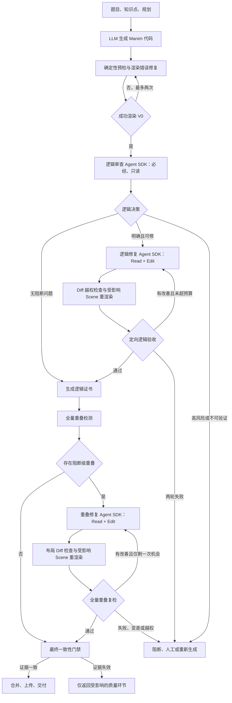

# Manim 企业级质量交付平台架构设计

- 日期：2026-07-10
- 状态：架构决策稿
- 范围：AI 生成 Manim 代码后的渲染修复、逻辑审查、重叠检测与修复、最终交付
- 核心技术：独立质量平台、Claude Agent SDK、确定性验证器、版本化质量状态机

## 1. 执行摘要

本方案采用“版本化、有界循环的质量状态机”，而不是单个大 Agent 或多个 Agent 自由协作。

最终决策如下：

1. 逻辑 Agent SDK 是所有成功渲染任务的必经环节。
2. 重叠检测对所有任务执行；重叠 Agent SDK 只在检测到阻断级重叠时触发。
3. Agent 负责理解问题和生成修改，外层编排器独占状态流转、渲染、验收、回滚和交付权。
4. 每次修改产生不可变的新 revision，代码、视频、检测报告和 Agent 报告全部绑定版本证据。
5. 逻辑修复和重叠修复均最多两次；相同 patch、无改善、变差或越权立即熔断。
6. 最终一致性门禁不调用 LLM，只进行轻量、增量、证据绑定的确定性核验。
7. 第一阶段实现为 `D:\manim_quality_platform` 独立模块化单体，不引入 Kafka 或微服务；生成端和现有 Render Worker 只能通过版本化提交契约接入，不能拥有质量状态或放行权。

平台目标不是完全取消人工，而是让人工从逐条视频审核者转为异常仲裁者和随机抽检者。绝大多数明确、低风险且证据完整的任务应自动交付。

## 2. 目标与边界

### 2.1 目标

- 每个交付视频都完成逻辑 Agent 审查和全量重叠检测。
- 自动修复明确、可验证的问题，并确保修复不会制造新的阻断问题。
- 支持有界循环、崩溃恢复、幂等重试和可靠回滚。
- 降低无效 Agent 调用、重复渲染和上下文重复读取。
- 保留完整审计链，能够解释每个视频为什么被允许交付。
- 使用真实生产留出集评估泛化能力，禁止针对单个样本定制修复规则。

### 2.2 非目标

- 不追求让一个 Agent 同时完成检测、修复、验收和发布。
- 不把 Agent 的“我已经修好”当作通过证据。
- 不在第一阶段重写现有生成、切片和渲染主链路。
- 不承诺所有开放式数学语义错误都能被确定性程序证明。
- 不允许通过删除内容、隐藏对象或样本特判让检测器变绿。

## 3. 架构选择

| 方案 | 正确性 | 循环控制 | Token/延迟 | 可观测性 | 结论 |
| --- | --- | --- | --- | --- | --- |
| 单个大 Agent | 低，容易上下文污染和自审自证 | 容易失控 | 最高 | 最差 | 排除 |
| 固定串行双 Agent | 中，职责有所分离 | 固定重跑较浪费 | 较高 | 中等 | 仅可作为过渡 |
| 版本化有界状态机 | 高，按证据和版本流转 | 局部循环、可熔断 | 最可控 | 最强 | 采用 |

这里的“事件驱动”指状态转换由持久化事件和证据触发，不代表第一版必须部署消息总线。第一版使用数据库状态、任务记录和文件制品即可。

## 4. 总体架构



逻辑顺序始终是“先逻辑、后重叠”。逻辑修复可能改变公式、点线关系或 Scene 结构并产生新的重叠，因此重叠验收必须基于逻辑最终版本。

执行层可做安全的推测并行：V0 渲染完成后，逻辑审查与 V0 重叠检测可以并行。如果逻辑 Agent 修改了代码，V0 重叠报告因 revision 不一致自动作废，并对新版本重新检测。第一阶段先串行实现，稳定后再启用该优化。

## 5. 阶段设计

### 5.1 输入与生成规格冻结

质量链路必须保存原始输入，而不是只保存最终 prompt：

- 用户题目或知识点。
- 规划 JSON、Scene 目标和教学顺序。
- 用户提供的标准答案或约束；没有时保持为空，禁止伪造 expected answer。
- 生成模型、提示词和模板版本。
- 画幅、TTS、颜色和渲染配置。

这些信息是逻辑 Agent 判断题意与视频代码是否一致的依据。

### 5.2 确定性预检与渲染修复

该阶段只解决“代码无法运行或无法渲染”的问题，包括语法、API 兼容、LaTeX、TTS 和已验证的确定性修复。它不负责逻辑正确性，也不负责布局重叠。

渲染修复最多两次。同一错误指纹重复、无进展或达到预算后停止，不能无限调用模型修补。

成功后创建不可变 baseline revision，并记录代码 hash、Scene hash、切片 hash 和渲染配置 hash。

### 5.3 逻辑审查 Agent：必经

逻辑审查 Agent 必须自己发现问题，不把外部 LLM 的诊断作为真相输入。输入包括：

- 原始题目、规划和可用的标准答案。
- 精简的 Scene 索引、文本、公式和几何事实摘要。
- 可读取的完整 `candidate.py`。
- 当前 revision 和渲染清单。

审查 Agent 只给 `Read` 权限，不给 `Edit`、Bash 或任意文件系统探索。它输出结构化结论：

- `PASS`：未发现有直接证据支持的阻断问题。
- `REPAIR`：问题明确、范围可控且存在验收方法。
- `RECORD_ONLY`：仅表示记录观察项，本身没有认证或放行含义；只有低严重度、低影响且证据完整的问题才可由平台策略转为 `CERTIFIED_WITH_WARNING`。
- `HUMAN_REVIEW`：高风险、证据冲突或无法可靠判断。

低置信不等于低风险。任何可能影响最终答案、几何关系或教学结论但无法验证的问题，必须进入 `HOLD` 或 `REGENERATE`，不得用警告状态交付。

Agent 的 PASS 表示“本次审查未发现问题”，不等同于数学上的绝对正确。平台需要通过真实标注集和生产抽样持续估计漏判率。

### 5.4 逻辑修复 Agent 与定向验收

逻辑修复 Agent 使用独立、无历史会话，避免继承 Reviewer 的自由推理。它只接收冻结后的 issue、目标 Scene、允许修改范围和验收条件，并使用 `Read + Edit`。

每次 patch 后依次执行：

1. AST 和 diff 越权检查。
2. 编译检查。
3. 只重渲染受影响 Scene。
4. 对可计算问题执行 Python/几何/公式 validator。
5. 对无法确定性验证的语义问题，调用轻量独立 Verifier，只读取原问题、issue、diff 和修改后的目标 Scene。

Verifier 不是全量二次审查，也不是最终一致性门禁。它只在发生逻辑修改且确定性验证不足时调用。

逻辑修复最多两轮。相同 patch、相同错误指纹、没有指标改善或第二轮失败时，转人工或重新生成。

### 5.5 全量重叠检测与条件修复

所有逻辑已认证版本都运行重叠检测。检测层应分为：

1. 原始事实层：对象身份、角色、bbox、时间区间、碰撞量、越界量和可见状态。
2. 版本化策略层：区分阻断问题、正常包含、刻意接触、动画过渡和低置信观察项。

当前检测代码中存在较多文本和场景类型特殊豁免。生产化时必须逐步转为对象角色、父子关系、时间关系和通用几何事实，避免检测策略向单样本特判发展。

只有至少一个高置信阻断问题时才调用重叠 Agent。推荐输入沿用已验证效果最好的形式：

- 完整 `candidate.py`。
- 精简 `layout_context.json`，包含全部阻断问题及必要周边对象。
- 上一轮 patch 与复检结果，仅在第二轮提供。
- 已通过的逻辑证书摘要，作为不可破坏约束。
- 极短的工具与行为协议。

第一版工具只提供 `Read + Edit`，不开放 Bash。渲染和检测继续由外层执行，避免工具 transcript 膨胀和 Agent 自证成功。

重叠修复最多两轮。第二轮只有在第一轮明确改善且仍有少量残留问题时允许执行。变差、无改善、语义越权或渲染失败立即回滚。

### 5.6 最终一致性门禁

最终门禁不调用 LLM，不重新理解整道题，也不固定重跑整条质量链。它核对：

- 最终代码是否与最终视频和切片来自同一 revision。
- 逻辑证书是否仍覆盖当前语义指纹。
- 重叠报告是否来自最终代码、最终渲染和当前检测器版本。
- 所有阻断 issue 是否关闭。
- patch 是否越过声明范围。
- 是否存在旧任务覆盖新版本、重复提交或重复上传。

如果证据失效，只返回被影响的环节。例如重叠修改触碰语义指纹时返回逻辑审查；重叠报告版本过期时只重新检测重叠。

## 6. Agent 角色与工具权限

| 角色 | 是否必经 | 工具 | 负责 | 不负责 |
| --- | --- | --- | --- | --- |
| Logic Reviewer | 是 | Read | 自主找逻辑问题、生成证据和 issue | 修改代码、放行交付 |
| Logic Coder | 条件触发 | Read、Edit | 按冻结 issue 做块级修复 | 自己决定修复成功 |
| Logic Verifier | 条件触发 | Read | 定向复核无法程序验证的逻辑修改 | 全量重新审查、修改代码 |
| Overlap Detector | 是，非 Agent | 固定检测接口 | 输出原始碰撞事实和阻断分类 | 修改代码 |
| Overlap Coder | 条件触发 | Read、Edit | 修复阻断级布局问题 | 自己运行最终验收、改变语义 |
| Quality Orchestrator | 是，非 Agent | 内部服务接口 | 状态、版本、渲染、验收、回滚、交付 | 数学推理和自由改代码 |

所有 Agent 默认无 Bash、无任意 Write、无仓库探索、无上传权限。将来是否加入 `run_check` 工具必须由对照实验决定；即使加入，外层仍须独立复检。

## 7. 有界循环与熔断

| 环节 | 正常调用 | 最大修复次数 | 熔断条件 |
| --- | ---: | ---: | --- |
| 渲染修复 | 按失败触发 | 2 | 相同错误、无改善、超时 |
| 逻辑审查 | 1 次，必经 | 不适用 | SDK 失败不能按 PASS |
| 逻辑修复 | 命中才调用 | 2 | 相同 patch、越权、无改善 |
| 逻辑 Verifier | 仅非确定性修复 | 每个候选 1 次 | 结论冲突转人工 |
| 重叠检测 | 1 次，必经 | 每个新 revision 重跑 | 检测失败不能跳过 |
| 重叠修复 | 命中才调用 | 2 | 变差、无改善、语义越权 |
| 最终门禁 | 1 次，无 LLM | 0 | 任一证据不一致 |

另设全局限制：

- 最多三个 Agent 产生的代码 revision。
- 同一 patch hash 不允许执行第二次。
- 同一错误指纹连续两轮无改善立即停止。
- 任意阶段只允许从对应的认证检查点派生候选版本：`render_baseline_revision`、`logic_certified_revision`、`layout_certified_revision` 或 `delivery_revision`。
- 失败 patch 永远不能覆盖已认证版本。

## 8. 版本与证据契约

每个候选版本至少保存：

```json
{
  "revision_id": "rev-...",
  "parent_revision_id": "rev-...",
  "stage": "LOGIC_REPAIR",
  "code_hash": "sha256:...",
  "semantic_fingerprint": "sha256:...",
  "scene_hashes": {},
  "render_manifest_hash": "sha256:...",
  "changed_scene_ids": [],
  "patch_scope": "scene_logic|layout_only",
  "created_by": "logic_agent|overlap_agent|system",
  "attempt": 1
}
```

逻辑证书至少绑定：

- revision ID。
- semantic fingerprint。
- 题目与规划 hash。
- Reviewer 模型、提示词和工具版本。
- decision、issues、confidence 和不确定项。
- token、耗时和原始结构化输出引用。

重叠证书至少绑定：

- 最终 code hash 和 render manifest hash。
- detector、probe 和策略版本。
- 原始问题数、阻断问题数和观察项数。
- 修复前后指标与 issue 映射。

最终交付证书引用逻辑证书、重叠证书、最终 revision 和最终视频 hash。

## 9. 语义指纹与修改分类

Hash 只能证明文件身份，不能证明重叠 patch 没有破坏数学语义。语义指纹需要基于 AST 和对象角色，至少覆盖：

- Text、Tex、MathTex、配音和结论字符串。
- 数值关系和公式常量。
- 点坐标、线端点、角度、半径、长度和比例。
- 点线角拓扑及对象增删。
- Scene 顺序、动画顺序和显隐逻辑。
- 条件、循环、索引和 updater。

只有认证的纯屏幕布局变化才能继承逻辑证书，例如说明文字移动、装饰元素移动或整个几何组统一平移。

以下变化必须使逻辑证书失效：

- 公式、文字、旁白或答案变化。
- 数学点坐标、线端点、角度、半径、比例变化。
- 单独移动具有数学语义的几何对象。
- 对象增删、构造顺序和动画顺序变化。
- 条件、循环、索引、显隐或 updater 变化。
- 任何无法可靠分类的 AST 修改。

不能使用 `shift`、`move_to` 等方法名白名单判断安全，因为同一方法既可能是纯布局，也可能改变数学模型。

## 10. 故障、回滚与幂等

- Agent SDK 暂时不可用：进入 `QUALITY_PENDING` 重试队列，不允许 fail-open。
- 渲染节点失败：保留 revision 和阶段状态，在其他 Worker 恢复。
- 修复后渲染失败：候选版本标记拒绝，回到当前阶段的认证检查点。
- 修复造成质量变差：立即拒绝并保存 diff，不覆盖已认证版本。
- 高危问题不可验证：阻断交付并进入人工或重新生成队列。
- 低风险观察项：可按产品策略记录后交付，但不能伪装成已修复。
- 阻断级重叠修复失败：不能静默交付仍有阻断问题的旧版本。

每个阶段使用幂等键：

```text
job_id + revision_id + stage + attempt + model_or_detector_version
```

基础设施重试同样有界。每次执行必须保存 `stage_run_id`、任务租约、心跳、截止时间、基础设施重试预算和终态；超过预算进入死信/HOLD，不允许因 SDK、渲染器或 Checker 故障无限重新入队和重复计费。

状态更新使用原子 revision 条件，旧任务不得覆盖新任务。上传只允许在最终证书通过后执行一次。

## 11. 效率设计

### 11.1 Agent 调用

- 无错误任务：通常只有一次 Logic Reviewer 调用。
- 仅有重叠任务：一次 Logic Reviewer 加一次 Overlap Coder。
- 逻辑可确定性修复：Reviewer 加 Coder，通常不需要 LLM Verifier。
- 逻辑非确定性修复：Reviewer、Coder 和一次定向 Verifier。
- 第二轮仅在存在明确改善时开放。

### 11.2 Token 优化

- Reviewer 先读压缩 Scene 索引，再按需读取目标 Scene。
- Logic Coder 只接收冻结 issue、目标 Scene 和必要 helper。
- Logic Verifier 只接收原 issue、before/after diff 和修改 Scene。
- Overlap Coder 保留完整单文件源码读取能力，但压缩 detector context 和工具 transcript。
- 每个角色使用无历史会话，避免前一角色的推理污染和上下文累积。
- 不传完整视频、原始巨量轨迹和无关渲染日志给 Agent。

### 11.3 渲染优化

- patch 只重渲染受影响 Scene。
- 未修改 Scene 复用原切片。
- 最后只重新执行廉价的拼接和 manifest 生成。
- 第一版串行保证正确性；稳定后把 V0 重叠检测与逻辑审查做推测并行。

## 12. 企业级运行控制层

要实现大量脱离人工审查，除 Agent 能力外还必须具备：

1. 持久化状态机：宕机后从准确阶段恢复。
2. 队列和资源池：Agent、渲染和检测可独立限流与扩容。
3. 版本化发布：模型、提示词、模板、validator 和检测策略均可回滚。
4. 灰度与 shadow：新版本先跑留出集，再影子运行，再小流量上线。
5. 审计与可追溯：保存每轮 before、after、diff、报告、tokens 和耗时。
6. 租户隔离与密钥管理：Agent 无任意文件系统和上传权限，密钥只来自受控环境。
7. 人工异常队列：只接收高危不确定、结论冲突和不收敛任务。
8. 生产抽检：即使自动通过，也按比例抽样以估计漏判率。

成熟平台的人工模式应从“逐条审核”转为：全部异常任务加少量随机抽检。自动化比例必须由生产留出集和持续抽检数据证明，不在架构阶段凭空承诺。

## 13. 与当前仓库的接口边界

当前线上主路径位于：

```text
apps/render/app/workers/video_task_processor.py
apps/render/app/workers/pipeline/
apps/render/app/workers/repair/
```

最小接入点是首次成功渲染和合并之后、切片持久化、水印和上传之前。旧 Render Worker 只增加提交客户端和交付结果适配器：

```text
pipeline_result
  -> quality_platform_client.submit(candidate)
  -> accepted_quality_result
  -> slice persistence / watermark / upload
```

旧仓库允许新增的边界仅限：

```text
apps/render/app/clients/manim_quality/
  client.py             # 版本化提交与状态查询
  contracts.py          # 生成端 DTO，不包含质量状态逻辑
  delivery_adapter.py   # 接收已认证结果并继续现有交付
```

质量状态、Agent、验收、回滚、证书和发布授权只存在于独立工作区：

```text
D:\manim_quality_platform\
```

逻辑能力迁移必须同时以 `post_render_logic` 自审 handoff 和后续
`tools/logic_engine_mvp/logic_engine_mvp` 为来源。前者提供已经验证过的
Claude Agent SDK 自审主体与结构化 issue 契约，后者补充确定性事实、受限
review input、issue verifier、repair contract、SDK Edit executor、validator 和
holdout guard。平台只增加 Adapter、revision/hash 绑定、权限、审计与最终验收，
不得另造第三个 Logic Agent。`logic_engine_mvp` 中历史 DeepSeek Reviewer 仅可做
离线基准，不进入生产必经链。

较早的 `post_render_logic` 单独使用时存在以下缺口；迁移时必须先核对后续
`logic_engine_mvp` 是否已经覆盖，不能丢失后来形成的能力：

- PASS 分支没有完整处理 blocked 和 human_review。
- Repair plan 只处理第一个 repairable issue。
- Coder 主要执行字符串 replacements，无法覆盖一般 Scene 逻辑修复。
- Recheck 只支持字符串存在/不存在。
- scope compliance 被固定写成通过。
- 新问题扫描被关闭。
- fixed code 没有和最终切片及视频形成事务性提交。

重叠能力目前位于 `D:\solver_contract_lab_mvp`。接入生产时应抽取 detector、context builder、SDK executor 和 validator 的稳定接口，不把批测 Harness、历史数据集和报告生成器整体搬进线上仓库。

## 14. 分阶段实施

### Phase 1：独立质量控制骨架

- 建立状态契约、revision store、证书和最终一致性门禁。
- 在 `D:\manim_quality_platform` 建立独立质量服务；`video_task_processor` 后续只通过提交接口接入，暂不启用自动 patch。
- 确保上传只能发生在最终门禁之后。
- 建立幂等、恢复、回滚和审计测试。

### Phase 2：Shadow 审查

- 所有成功渲染任务运行 Logic Reviewer 和重叠检测，但不阻断、不修改。
- 使用真实标注集和人工抽检测量误报、漏报、tokens 和延迟。
- 冻结最终验收集，调试时禁止查看其答案。

### Phase 3：逻辑自动修复

- 开启高置信、范围明确且可验收问题的自动修复。
- 增加 AST diff guard、Scene 级重渲染和定向 Verifier。
- 第二轮仅对第一轮有改善的任务开放。

### Phase 4：重叠条件修复

- 接入全量 detector 和阻断策略。
- 命中才调用 Claude Agent SDK direct 模式。
- 增加语义指纹、布局范围检查、全量复检和自动回滚。

### Phase 5：企业化与性能优化

- 开启推测并行和独立 Worker 池。
- 增加限流、熔断、SLO、告警和容量规划。
- 按生产数据逐步降低人工抽检比例。

### 用户二次修改发布约束

用户修改的预览版本可以只做定向渲染以保持交互速度，但用户批准发布的每个候选版本都必须重新进入完整质量链：`Logic Reviewer -> 必要时修复与验证 -> 全量重叠检测 -> 最终一致性门禁`。不得复用旧逻辑证书直接发布，也不得在部分 Scene 修改失败后静默拼接旧切片交付。

## 15. 验收指标

### 15.1 架构正确性

- 100% 已交付视频具有最终 revision、逻辑证书和重叠证书。
- 0 个证据 hash 与最终代码或视频不一致的任务被放行。
- 0 个未通过渲染或最终门禁的 patch 被接受。
- 0 个重复上传或旧 revision 覆盖新 revision 的任务。
- 100% 失败 patch 可回滚到当前阶段的认证检查点。

### 15.2 Agent 与循环

- 无问题任务只发生一次必需的逻辑 Agent 审查。
- 逻辑和重叠修复均不超过两轮。
- 相同 patch 重复执行率为 0。
- 无改善后继续消耗 Agent 调用的比例为 0。
- 所有调用均记录输入、输出、tokens、耗时、模型和提示词版本。

### 15.3 质量指标

- 重叠修复后被接受但质量变差的比例为 0。
- 逻辑自动修复在冻结留出集上的安全通过率达到上线阈值后才允许扩量。
- 阻断级重叠 detector 的召回率和误报率必须由人工标注集证明。
- 持续统计 Reviewer 的高危漏判率、误报率和人工推翻率。
- 训练/调优集和最终留出集分别报告，禁止只公布 supported 子集成功率。

具体数值阈值应基于第一轮 shadow 数据制定，不能用当前小样本结果替代生产 SLA。

## 16. 主要风险与控制

| 风险 | 控制措施 |
| --- | --- |
| Logic Reviewer 漏判 | 真实留出集、低置信分流、生产随机双审和人工抽检 |
| Reviewer 与 Coder 相互强化错误 | 独立无历史会话、冻结 issue、外层验收 |
| 修复引入新问题 | AST/diff guard、定向新风险扫描、受影响 Scene 重渲染 |
| 重叠修改破坏数学含义 | 对象角色加 AST 语义指纹，未知变化一律失效 |
| 检测策略过拟合样本 | 原始事实层与策略层分离、留出集、禁止 case/text 特判 |
| Agent 无限循环 | 两轮上限、无改善熔断、全局 revision 上限 |
| Token 过高 | 分角色输入、按需读取、定向复核、无历史会话 |
| 重复渲染和上传 | Orchestrator 独占副作用、Scene 级缓存、幂等键 |
| SDK 或 Worker 故障 | QUALITY_PENDING、持久化恢复、限流和故障隔离 |
| 架构过重 | 第一版模块化单体，只在稳定后按瓶颈拆分 |

## 17. 最终架构原则

1. 代码 revision 是唯一真相源。
2. 所有报告和视频必须绑定 revision，而不是依赖文件名或内存状态。
3. Agent 负责理解和修改，平台负责验收和交付。
4. 逻辑 Agent 必经，重叠 Agent 条件触发。
5. 修复按 Scene 和问题定向执行，不做无边界全局重写。
6. 循环必须有改善证据和硬上限。
7. 未验证的 patch 永远不能上线。
8. 最终一致性门禁保持轻量、确定性和无 LLM。
9. 人工只处理异常与抽检，不参与正常流水线。
10. 所有优化以真实生产留出集结果为依据，不为单独案例写补丁。
