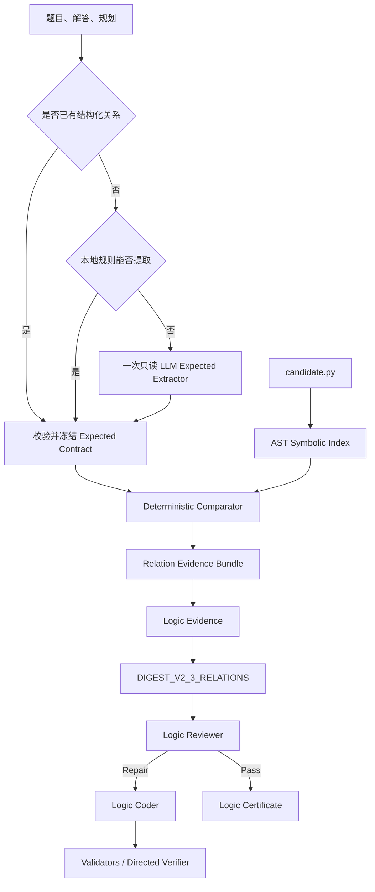

# Expected/Actual Relation 模块与正式链路接入方案

- 文档日期：2026-07-14
- 状态：待实施设计
- 目标：将题目预期关系与代码实际关系的确定性比较，作为 Logic Reviewer 的
  版本化前置证据
- 非目标：用该模块替代 Reviewer、Coder、Verifier 或最终质量门禁

## 1. 背景

当前 Logic Reviewer 已经能够读取：

- 题目文本；
- 可选标准解；
- 生成规划；
- 可见数学结论；
- 数值向量；
- Manim 构造调用；
- 完整 `candidate.py`。

但当前 Reviewer 仍需要自己完成一个代价很高且容易漏判的过程：

1. 从自然语言理解题目要求的几何关系；
2. 在代码中找到对应点和线；
3. 计算实际关系；
4. 判断二者是否矛盾；
5. 给出准确源代码行号。

Expected/Actual Relation 模块的目标，是把其中可结构化、可确定性计算的部分
提前完成，再把事实交给 Reviewer。

## 2. 当前模块组成

### 2.1 ExpectedRelationExtractor

文件：

```text
src/manim_quality/logic/expectations/extractor.py
```

职责：

- 只读取题目、解答和规划；
- 不读取候选代码；
- 不读取 Mutation Ground Truth；
- 不输出修复建议；
- 提取带原文引用的明确数学关系。

当前支持关系：

- `line_endpoints`；
- `point_on_line`；
- `parallel`；
- `perpendicular`；
- `collinear`；
- `equal_length`；
- `midpoint`；
- `point_coordinate`；
- `segment_length`；
- `intersection`。

### 2.2 SymbolicGeometryIndex

文件：

```text
src/manim_quality/logic/expectations/symbolic_index.py
```

职责：

- 使用 Python AST；
- 识别字面量 Point 和 `Dot`；
- 识别 `Line`、`DashedLine`、`Arrow` 和 `DoubleArrow`；
- 保留 Symbolic Endpoint Reference；
- 支持 `AD`、`line_AD` 和由命名点组成的虚拟线段；
- 动态或无法证明的值返回 Unknown，不猜测。

### 2.3 Comparator

文件：

```text
src/manim_quality/logic/expectations/comparison.py
src/manim_quality/logic/expectations/numeric_comparison.py
```

输出：

- `satisfied`；
- `contradiction`；
- `unknown`。

每个结果绑定：

- Expected Claim；
- 题目原文引用；
- Actual Observation；
- Candidate Source Lines；
- Reason Code。

## 3. 为什么没有直接接入

独立 Probe 已经证明方向可行，但还存在以下问题：

1. 原始 11 条数据中混有不可渲染 Mutation；
2. 静态 AST 对 Helper、Updater、动态变换和 3D 支持不足；
3. 原始 11 条 Unknown Claim 达到 60.9%；
4. Runtime Final-State Capture 在正确原代码上制造了 7 个假矛盾；
5. 新来源端到端样本只有 1 个；
6. 还没有 20 条以上独立冻结、预先确认可渲染的盲测；
7. 45 条 E2E 实验为了保持变量可解释，明确冻结在 `DIGEST_V2_1`。

所以当前模块应继续作为 Shadow Evidence，而不是直接替换生产 Reviewer 路线。

## 4. 目标架构



## 5. 关键设计原则

### 5.1 结构化输入优先

Expected 关系来源优先级：

1. 上游提交的结构化 Expected Relation Contract；
2. 可证明的本地规则解析；
3. 一次只读 LLM 提取；
4. 无法提取时返回空 Contract 或 Unknown，不伪造。

### 5.2 题目关系只提取一次

题目关系缓存 Key：

```text
sha256(
  problem_text
  + expected_answer
  + planning
  + extractor_prompt_version
  + relation_schema_version
  + model_identity
)
```

同一道题重新生成代码、逻辑修复或重叠修复时，不应重复调用题目提取 LLM。

### 5.3 代码关系本地计算

Actual Relation Index 缓存 Key：

```text
sha256(candidate_code_hash + scene_id + symbolic_index_version)
```

代码关系提取和比较不调用模型。

### 5.4 Evidence 不拥有放行权

- `contradiction` 可以提高 Reviewer 发现错误的概率；
- `satisfied` 只说明已支持的某条关系成立；
- `unknown` 不得支持 PASS、Warning 或自动修复；
- Reviewer 仍然需要结合题目、代码和其他逻辑事实作出结构化结论；
- Agent 修改后仍需外层重渲染和验证。

## 6. 建议新增的数据契约

建议新增：

```text
src/manim_quality/logic/expectations/evidence.py
```

示例结构：

```json
{
  "schema_version": "manim-quality.relation-evidence.v1",
  "candidate_code_hash": "sha256:...",
  "expected_contract_hash": "sha256:...",
  "extractor": {
    "source": "structured|local|llm|none",
    "prompt_version": "expected-relations-v2",
    "model": "..."
  },
  "scenes": [
    {
      "scene_id": "DemoScene",
      "comparisons": [
        {
          "claim_id": "R-001",
          "relation": "parallel",
          "operands": ["EG", "AC"],
          "status": "contradiction",
          "source_quote": "EG平行于AC",
          "source_kind": "problem",
          "candidate_lines": [82, 85],
          "actual": {
            "left_direction": [-1, 1],
            "right_direction": [3, -1]
          },
          "reason_code": "direction_not_parallel"
        }
      ]
    }
  ],
  "counts": {
    "satisfied": 2,
    "contradiction": 1,
    "unknown": 3
  }
}
```

契约要求：

- 严格字段集合；
- 值不可变；
- 绑定 Candidate Code Hash；
- 绑定 Expected Contract Hash；
- 每个 Contradiction 必须有 Source Quote 和 Candidate Line；
- 禁止 Repair Hint、Replacement Text 和 Sample Ground Truth；
- 不允许 NaN、Infinity 和未声明字段。

## 7. 精确代码接入点

### 7.1 新增 Relation Evidence Service

建议新增：

```text
src/manim_quality/logic/expectations/service.py
src/manim_quality/logic/expectations/evidence.py
src/manim_quality/logic/expectations/cache.py
```

Service 负责：

1. 选择 Structured、Local 或 LLM Expected Provider；
2. 构建并缓存 Expected Contract；
3. 对每个 Scene 构建 Symbolic Index；
4. 运行 Comparator；
5. 输出 Hash-Bound Relation Evidence。

### 7.2 扩展 LogicEvidence

修改：

```text
src/manim_quality/logic/evidence.py
```

新增字段：

```python
relation_evidence: RelationEvidenceBundle | None
```

构建时必须校验 Candidate Code Hash。

### 7.3 新增 Reviewer 输入版本

修改：

```text
src/manim_quality/logic/review_input.py
src/manim_quality/logic/review_digest.py
```

新增：

```text
DIGEST_V2_3_RELATIONS
```

不要修改 `DIGEST_V2_1` 的行为。保留旧版本用于 A/B 和回滚。

Digest 只携带：

- 所有 Contradiction；
- 高风险 Unknown 的有限摘要；
- Satisfied 数量；
- Truncation 计数；
- Evidence Hash 和版本。

不要把 87 条原始 Claim 全部塞进 Prompt。

### 7.4 Workbench Shadow 接入

修改：

```text
evals/_logic_shadow_case.py
evals/workbench_e2e/logic_stage.py
evals/run_logic_reviewer_shadow.py
```

要求：

- 默认仍使用 `DIGEST_V2_1`；
- 通过显式参数启用 `DIGEST_V2_3_RELATIONS`；
- 同一冻结样本同时运行 Baseline 和 Relation 两个 Route；
- 每条样本均输出 Relation Evidence、Reviewer Report、Tokens 和耗时；
- 不允许只保存成功样本。

### 7.5 生产接入

生产不修改：

```text
src/manim_quality/orchestrator/service.py
```

Reason：Orchestrator 只理解 `LogicReviewPort.assess()`，不应理解数学关系。

Relation Service 应由 Logic Review Adapter 内部注入，作为构建
`LogicEvidence` 的一个 Provider。

## 8. LLM 调用策略

不是每个视频固定增加一次 LLM。

| 情况 | Expected 提取调用 |
|---|---:|
| 已有结构化关系 | 0 |
| 本地规则可提取 | 0 |
| 新题且只有自然语言 | 1 |
| 同题重新生成代码 | 0，使用缓存 |
| Logic Coder 修改代码 | 0，复用 Expected，重建 Actual |
| Overlap Coder 修改布局 | 0，复用 Expected，按代码 Hash 重建 Actual |

现有 SDK 提取平均 9,875 Tokens/题，输出/推理占比 65.5%。优化方向：

- 测试一轮无工具 Structured Output；
- 减少解释性输出，只保留 Claim 和 Source Quote；
- 对重复题目强制 Cache Hit；
- 优先消费上游结构化规划；
- 对没有显式关系的题目允许空 Claim，不强迫模型猜测。

## 9. 测试计划

### 9.1 单元测试

必须覆盖：

- Schema 严格字段；
- Unsupported Relation 拒绝；
- Source Quote 缺失拒绝；
- Candidate Hash 不匹配拒绝；
- Point/Line Alias；
- 动态值返回 Unknown；
- 满足、矛盾和 Unknown；
- 删除、重命名和多 Scene；
- 缓存 Key 和版本失效；
- 禁止 Ground Truth 和 Repair Hint。

### 9.2 集成测试

至少包含：

- Structured Expected，无模型调用；
- Local Expected，无模型调用；
- LLM Expected 一次调用并缓存；
- 相同题目不同代码复用 Expected；
- Reviewer 能引用 Relation Contradiction；
- Reviewer 不把 Unknown 当成 PASS；
- Logic Coder 修复后重新比较；
- Relation Evidence 过期时 Final Gate 拒绝。

### 9.3 Shadow A/B

至少准备：

- 20 个新的、独立确认可渲染的结构关系错误；
- 每个错误对应 untouched original control；
- 不使用旧 11 条作为最终验收；
- 按 Line Endpoint、Point on Line、Parallel、Perpendicular、Coordinate 分层；
- 先冻结样本，再运行任何模型。

对比：

```text
DIGEST_V2_1
vs
DIGEST_V2_3_RELATIONS
```

报告：

- Target Recall；
- Control False Positive；
- Unknown Rate；
- Reviewer Harness Failure；
- Tokens；
- Model Rounds；
- 平均耗时；
- 过度修复率；
- 修复后重渲染成功率。

## 10. Promotion Gate

该模块升级为默认 Reviewer Evidence 前，至少满足：

- 确定性 Known Facts 错误数为 0；
- Critical Control False Positive 为 0；
- 总 Control False Positive 小于 10%；
- 支持关系子集 Recall 有明确提升；
- 不增加 Reviewer Harness Failure；
- 平均 Tokens 不显著高于 Baseline；
- Expected 提取在同题重试时 100% Cache Hit；
- 所有 Attempted Sample 都进入报告；
- 没有 Sample ID、标题、对象名或目录分支；
- 修复后仍通过外层重渲染和定向验证。

即使通过，也只能作为 Reviewer Evidence，不能成为独立交付门禁。

## 11. Runtime Capture 边界

当前不要启用“Scene 最终状态坐标直接比较”。

独立实验发现：

- Runtime Capture 将 Unknown 从 25 降到 3；
- 但在正确原代码上制造了 7 个假矛盾。

根因：

- VGroup 后续整体移动或缩放；
- 原始 numpy Point 变量与 Mobject 最终位置不同步；
- 示意图中的等长和中点不一定按真实比例绘制；
- 最终状态丢失关系首次成立的动画 Checkpoint。

未来 Runtime 方案必须：

- 在 `Scene.play` 边界捕获；
- 使用稳定 Logical ID；
- 只在关系对象同时可见时比较；
- 拓扑关系优先；
- Metric Relation 默认 Unknown，除非规划声明按比例绘制。

## 12. Rollback

接入必须是版本化和可回滚的：

- `DIGEST_V2_1` 保持不变；
- `DIGEST_V2_3_RELATIONS` 使用独立 Prompt、Schema 和 Policy Version；
- 通过 Tenant 或 Queue Policy 控制 Shadow 百分比；
- Relation Provider 异常时 Fail Closed 到 Hold，或按明确策略回退 Baseline；
- 不能静默删除 Relation Evidence 后仍标记新版本运行成功。

## 13. Definition of Done

以下条件全部满足才算接入完成：

1. Relation Evidence Contract 和 Cache 完成；
2. `LogicEvidence` 完成 Hash Binding；
3. 新 Digest 版本完成；
4. Baseline Route 行为未变化；
5. Unit 和 Integration Tests 通过；
6. 20 对新 Holdout 完成 A/B；
7. 视频全部重新渲染验证；
8. Tokens、Rounds、False Positive 和 Unknown 完整记录；
9. 无 Sample-Specific Rule；
10. 决策文档明确记录 Promote、继续 Shadow 或 Reject。

