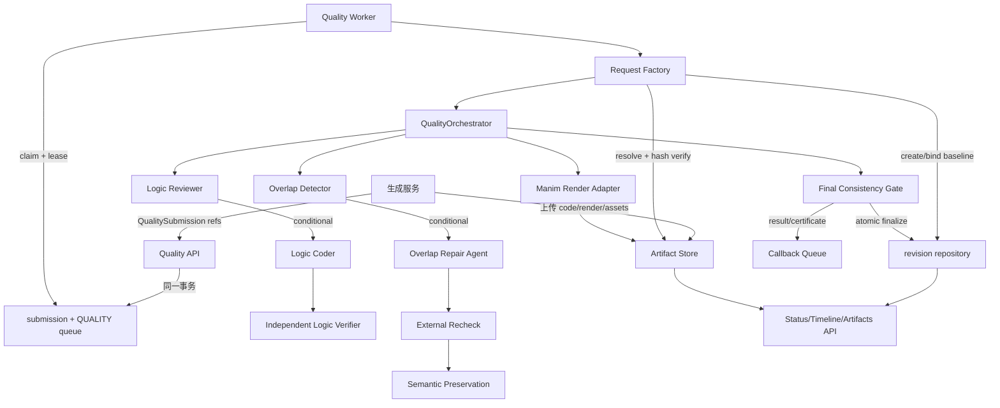

# 生产全链路编排与原子化部署确认方案

> **For Claude:** REQUIRED SUB-SKILL: Use superpowers:executing-plans to implement this plan task-by-task.

**Goal:** 建立唯一、可启动、可追踪、可查询的 Manim 质量平台生产管线，使 API、队列、真实 Logic/Overlap Agent、渲染、持久化和交付不再依赖部署人员临时手写适配器。

**Architecture:** 保留现有领域状态机、Agent 能力和存储仓储，在其外新增一个生产 composition root。composition root 是唯一负责读取配置、解析 Artifact Ref、实例化 9 个编排端口、创建 Orchestrator、启动 Worker 和暴露查询接口的地方；任何业务模块不得自行拼接另一条流程。

**Tech Stack:** Python 3.11/3.12、FastAPI、SQLite 本地验收、PostgreSQL 生产、内容寻址对象存储、Claude Agent SDK、Manim CLI、pytest。

---

## 1. 先给结论

当前仓库不是“完全没有流程”，而是存在两条没有汇合的流程：

1. `evals/workbench_e2e` 是已经真实跑过 Agent、Manim 和重叠检查的文件型实验管线。
2. `apps/api`、`apps/worker`、`manim_quality/orchestrator` 和 `storage` 是企业服务骨架，具备 API、队列、状态机、幂等、租约和数据库契约。

两者之间缺少生产 composition root 和真实端口适配器。V2 交接包解决了 vendor、Hash payload 和 Python 3.12 导入问题，但只达到“运行时依赖完整”，没有达到“API 提交后可自动完成全链路”。部署方手写路由和适配器，是在填补真实缺口，不是单纯不会使用。

在缺口补齐前，不应再把 V2 描述为开箱即用的生产服务。它是依赖完整、核心模块可运行的工程交接包。

## 2. 已核实的断链位置

| 编号 | 当前已有 | 实际缺口 | 后果 |
|---|---|---|---|
| G01 | `apps/api/main.py::create_app()` | 没有环境配置加载、模块级 `app` 或正式启动命令 | Uvicorn 无法只靠配置启动 |
| G02 | POST `/v1/quality/jobs` 会写 submission 和 QUALITY queue | 没有生产 `request_factory` | Queue payload 无法转成 `ExecutionRequest` |
| G03 | Intake 保存 `candidate_code_ref` 等引用 | 没有 Artifact Resolver/上传入口 | Worker 拿不到真实代码、manifest 和 assets |
| G04 | `QualityOrchestrator.execute()` 要求 baseline job/revision 已存在 | Intake 不创建 `quality_jobs` 和 baseline revision | Worker 直接调用 Orchestrator 会在 `begin_run()` 前后失败 |
| G05 | Orchestrator 定义 9 个严格端口 | Logic、Layout、Renderer 只有领域能力或 eval 包装，没有生产端口组合 | 只能在测试中靠 Fake 端口跑通 |
| G06 | `ManimRenderAdapter` 支持 ArtifactStore | 没有生产 Manim `Renderer`、环境认证器和复用认证器 | 真实渲染无法注入 Orchestrator |
| G07 | `LocalArtifactStore` 可内容寻址存储 | 未纳入 `StorageFactories`，也没有 S3/COS 实现 | DB 和文件/视频存储断开 |
| G08 | `create_quality_worker()` 可创建 Worker | 没有 worker CLI、轮询循环和统一 shutdown | 部署方必须自己写进程入口 |
| G09 | Delivery 生成 `content://<hash>` | 这些引用是字符串拼接，未确认对应 Artifact 已落盘 | 查询到 ref 也不一定能下载内容 |
| G10 | API 能查 job/revisions/evidence/certificate | 没有 stage timeline、完整 evidence payload、代码/视频下载接口 | 难以定位断在哪一步，也拿不到最终成品 |
| G11 | `evals/run_workbench_e2e.py` 可跑真实垂直流程 | 它绕过 API、Queue、`QualityOrchestrator` 和数据库 | 实验成功不等于服务部署成功 |

## 3. 唯一目标链路



## 4. 原子化一一对应确认表

每个阶段必须留下 `stage_run` 记录。没有记录就视为没有执行，不能通过日志猜测。

| 原子 | 输入 | 唯一执行者 | 输出 | 持久化位置 | 通过标准 |
|---|---|---|---|---|---|
| A00 Doctor | 配置、Python、SDK、Manim、vendor | bootstrap CLI | capability report | deployment report | 所有 required capability 为 PASS |
| A01 Artifact Intake | code/video/manifest/assets bytes | Artifact Store | `ArtifactRef` | object store `sha256/<prefix>/<hash>` | put 后 get，大小与 SHA-256 一致 |
| A02 Submission | `QualitySubmission` refs | API intake | receipt | `quality_submissions`、`quality_queue` | 两表同一事务，queue=QUEUED |
| A03 Claim | QUALITY queue row | Quality Worker | fenced lease | `quality_queue` | owner/token/deadline 完整，重复 Worker 抢不到 |
| A04 Request Bind | queue payload + Artifact refs | Request Factory | `ExecutionRequest` + baseline | `quality_jobs`、`quality_revisions` | 引用全部可解析且 Hash 绑定，baseline 只创建一次 |
| A05 Baseline Render | baseline source | Render Port | render binding + video | object store + stage evidence | Manim return code 0，manifest/video Hash 可复读 |
| A06 Logic Review | 题目、规划、答案、代码、render evidence | Logic Review Port | CLEAN/REPAIR/WARNING/HOLD | `quality_stage_runs` + evidence | 决策、引用行、usage、版本均落库 |
| A07 Logic Repair | review issues + source | Logic Repair Port | candidate revision | object store + `quality_revisions` | 最小 diff，父 revision 正确，不能自行晋级 |
| A08 Logic Verify | repaired source + re-render + issues | 独立 Logic Verifier | logic certificate | evidence + checkpoint | 原问题关闭，无新 blocker，Hash 与 revision 一致 |
| A09 Layout Detect | 当前 revision + layout probe | Layout Detect Port | blocking issues/context | stage evidence | detector 成功；0 issue 时不调用 Repair Agent |
| A10 Layout Repair | code + 精简 context | Layout Repair Port | candidate revision | object store + revision | 外部 recheck 后 blocking 减少或归零 |
| A11 Semantic Recheck | logic checkpoint + final candidate | 独立 Semantic Port | PRESERVED/REJECTED | evidence | 逻辑关系未改变；不接受 Repair Agent 自证 |
| A12 Final Gate | 全部 certificates + final render | Orchestrator | ACCEPT/WARNING/HOLD | `quality_runs`、`quality_jobs`、evidence | 结果、certificate、artifact refs 同一提交完成 |
| A13 Callback | terminal result | Callback Worker | signed callback receipt | CALLBACK queue/replay | 幂等、可重试、不能重复交付 |
| A14 Readback | tenant + job_id | Read API | status/timeline/files | DB + object store | 可从 job_id 找到输入、每阶段证据和最终视频 |

## 5. Stage Run 最小数据契约

新增 `quality_stage_runs`，不要把所有诊断信息塞进日志文本：

```json
{
  "schema_version": 1,
  "job_id": "job-...",
  "run_id": "quality:job-...",
  "stage_run_id": "logic-review:...",
  "stage": "LOGIC_REVIEW",
  "attempt": 1,
  "component_id": "logic-reviewer",
  "component_version": "...",
  "input_hashes": {},
  "output_hashes": {},
  "artifact_refs": {},
  "status": "SUCCEEDED",
  "decision": "REPAIR",
  "token_usage": {
    "input": 0,
    "output": 0,
    "cache_read": 0,
    "cache_write": 0
  },
  "started_at": "...",
  "finished_at": "...",
  "elapsed_ms": 0,
  "error_code": null,
  "error_detail_ref": null
}
```

约束：

- `input_hashes` 必须来自上一个原子的正式输出。
- 大 payload 只存 Artifact Ref，数据库不存整段 prompt、代码或视频。
- 错误详情可存私有 evidence artifact，公共 API 只返回稳定 `error_code`。
- Agent usage 必须由 SDK usage 事件记录，不能估算。
- 同一 `(job_id, run_id, stage, attempt)` 只能有一条记录。

## 6. 存储数据如何获取

### 6.1 当前已经可以查询

| 数据 | API | 数据库来源 |
|---|---|---|
| 任务状态和最终 result | `GET /v1/quality/jobs/{job_id}` | submissions、queue、jobs、runs |
| revision 元数据 | `GET /v1/quality/jobs/{job_id}/revisions` | `quality_revisions` |
| checkpoint evidence Hash | `GET /v1/quality/jobs/{job_id}/evidence` | `quality_jobs` |
| 最终 certificate | `GET /v1/quality/jobs/{job_id}/certificate` | `quality_evidence` |

### 6.2 当前还拿不到或不可靠

- revision 对应的真实 `candidate.py`；当前 revision 只保存 Hash 和元数据。
- 最终视频的可下载 URI；certificate 有视频 Hash，但 Read API 没有下载路由。
- 每个 Agent 的输入、输出、耗时、Tokens 和具体失败点。
- `content://...` 对应的物理对象；Delivery 当前会拼接 ref，但没有在同一步验证对象存在。
- 完整状态迁移 timeline；数据库有 transitions，但 API 没有暴露。

### 6.3 必须增加的读取接口

| 接口 | 用途 | 权限 |
|---|---|---|
| `GET /v1/quality/jobs/{job_id}/stages` | 按时间返回原子阶段状态 | tenant owner |
| `GET /v1/quality/jobs/{job_id}/artifacts` | 返回 code/manifest/video/evidence refs | tenant owner |
| `GET /v1/quality/artifacts/{hash}` | 返回短期签名下载地址或流式内容 | ref + tenant binding |
| `GET /internal/quality/jobs/{job_id}/diagnostics` | 完整错误、usage、版本 | operator only |

生产对象存储建议：

```text
quality/{tenant_id}/{job_id}/input/candidate/<sha256>.py
quality/{tenant_id}/{job_id}/input/render-manifest/<sha256>.json
quality/{tenant_id}/{job_id}/revisions/{revision_id}/candidate/<sha256>.py
quality/{tenant_id}/{job_id}/renders/{revision_id}/video/<sha256>.mp4
quality/{tenant_id}/{job_id}/evidence/{stage}/{sha256}.json
quality/{tenant_id}/{job_id}/delivery/<certificate-sha256>.json
```

物理 key 可以带租户和任务层级以便运维，但身份仍以内容 SHA-256 为准。

## 7. 应补建的生产模块

### Task 1: 建立配置与 Doctor

**Files:**
- Create: `src/manim_quality/bootstrap/settings.py`
- Create: `src/manim_quality/bootstrap/doctor.py`
- Create: `apps/pipeline/__main__.py`
- Test: `tests/integration/bootstrap/test_doctor.py`

验收：缺数据库、对象存储、Manim、vendor、SDK 或模型配置时，在启动前明确失败；不允许 Worker 运行后才发现。

### Task 2: 建立 Artifact Resolver 和 Request Factory

**Files:**
- Create: `src/manim_quality/bootstrap/artifacts.py`
- Create: `src/manim_quality/bootstrap/request_factory.py`
- Modify: `src/manim_quality/storage/factory.py`
- Test: `tests/integration/bootstrap/test_request_factory.py`

职责：严格解析 Queue 中的 `QualitySubmission`，读取并验证所有 refs，建立幂等 baseline revision，生成唯一 `ExecutionRequest`。这是当前最关键断链。

### Task 3: 建立真实 Logic 编排端口

**Files:**
- Create: `src/manim_quality/runtime/logic_ports.py`
- Modify: `src/manim_quality/logic/repair_flow.py`
- Test: `tests/integration/runtime/test_logic_ports.py`

Reviewer、Coder 和 Verifier 使用现有 SDK 能力，但必须转换成 Orchestrator 的 `StageAssessment`、`RepairProposal` 和 `LogicCertificate`。三者保持独立 identity/session。

### Task 4: 建立真实 Layout 编排端口

**Files:**
- Create: `src/manim_quality/runtime/layout_ports.py`
- Create: `src/manim_quality/runtime/layout_probe.py`
- Test: `tests/integration/runtime/test_layout_ports.py`

把 `evals/workbench_e2e/layout_stage.py` 中已验证的 probe、context 和 vendor 调用迁移到生产模块，eval 只能调用生产模块，不能继续拥有另一份业务流程。

### Task 5: 建立真实 Render Port

**Files:**
- Create: `src/manim_quality/runtime/manim_renderer.py`
- Create: `src/manim_quality/runtime/render_port.py`
- Test: `tests/integration/runtime/test_render_port_real.py`

实现 `Renderer.compile/render_scene/concatenate`，所有产物先写 Artifact Store，再构建 RenderManifest。禁止只把本地临时路径写入数据库。

### Task 6: 建立唯一 Composition Root

**Files:**
- Create: `src/manim_quality/bootstrap/container.py`
- Create: `apps/api/__main__.py`
- Create: `apps/worker/__main__.py`
- Modify: `apps/api/main.py`
- Modify: `apps/worker/main.py`
- Test: `tests/e2e/test_production_composition_sqlite.py`

Container 必须一次性实例化 Storage、Artifact Resolver、9 个端口、Orchestrator、Request Factory 和 Worker。部署方只传配置，不再传 Python 对象或手写路由。

### Task 7: 增加 Stage Ledger 和读取接口

**Files:**
- Create: `migrations/0005_stage_runs_and_artifacts.sql`
- Create: `src/manim_quality/observability/stage_ledger.py`
- Modify: `apps/api/routes/revisions.py`
- Modify: `apps/api/service.py`
- Test: `tests/integration/test_stage_readback.py`

验收：一个 job 能完整回放 A01-A14，每个阶段都能看到输入 Hash、输出 Hash、耗时、Tokens、版本和错误码。

### Task 8: 建立真正的全流程验收命令

**Files:**
- Create: `scripts/run_production_vertical_slice.py`
- Create: `docs/runbooks/production-pipeline.md`
- Test: `tests/e2e/test_production_vertical_slice.py`

目标命令：

```powershell
python -m apps.pipeline doctor
python scripts/run_production_vertical_slice.py --database .tmp/quality.sqlite3 --artifacts .tmp/artifacts --case samples/known_overlap
python -m apps.pipeline inspect --job-id <job_id> --json
```

最终验收必须使用真实 Logic SDK、真实 overlap vendor 和真实 Manim；可以使用 SQLite 和本地 Artifact Store，但不得使用 Fake Reviewer、Fake Renderer 或 Fake Repair。

## 8. 全流程验收标准

必须同时满足：

1. 一条 clean 样本从提交到 ACCEPT，Logic Agent 必经，Overlap Repair 不调用。
2. 一条 logic error 样本触发 Reviewer、Coder、独立 Verifier，重渲染后 ACCEPT。
3. 一条 overlap 样本触发 detector、Repair Agent、外部 recheck、semantic preservation 后 ACCEPT。
4. 一条不可修样本进入 HOLD，并能查询稳定错误码和最后成功原子。
5. 同一 idempotency key 重提不产生第二个 job。
6. Worker 中途退出后可凭 lease 恢复，不重复晋级 revision。
7. 从 result 中的每个 Artifact Ref 都能下载并通过 SHA-256 校验。
8. API、DB、Stage Ledger、对象存储的 job/revision/hash 一一对应。
9. callback 重试不造成重复交付。
10. 单个 job 可导出一份不含密钥的完整诊断包。

## 9. 部署方现在应如何处理

在正式 composition root 完成前有两个诚实选项：

- 需要马上验证 Agent 效果：使用 `evals/run_workbench_e2e.py`，接受它是文件型实验流水线，不是生产 API。
- 需要接企业 API：暂时保留部署方适配层，但冻结成单一模块，按 A00-A14 记录边界证据；不要继续在多个服务里散落路由和临时 glue code。

不建议把部署方当前手写的适配器直接视为最终架构。应先对照 G01-G11 做差距审计，能复用的迁入 `runtime/` 和 `bootstrap/`，其余删除，最终只保留一个 composition root。

## 10. Definition of Done

只有下列事实同时成立，才能再次称为“可直接部署的完整平台”：

- 一个公开且文档化的 API 入口。
- 一个公开且文档化的 Quality Worker 入口。
- 一个无 Fake 的真实本地垂直切片命令。
- 所有 Orchestrator 端口均有生产实现并由 Container 注入。
- 输入和输出 Artifact 均可解析、可下载、可 Hash 校验。
- A00-A14 全部产生结构化 stage records。
- 部署方不需要自行编写任何业务适配器或路由。
