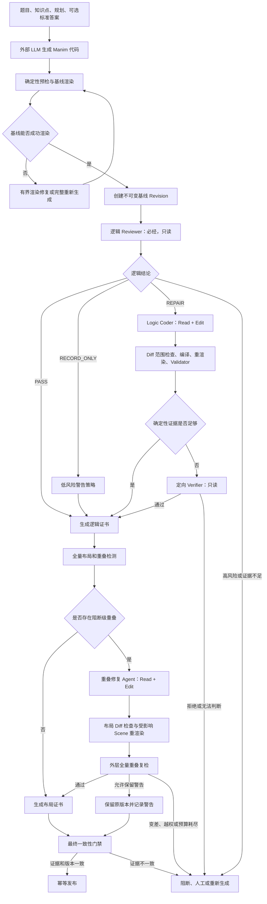

# Manim 质量平台 Agent 架构与测试总报告

- 报告日期：2026-07-13
- 证据时间范围：2026-07-10 至 2026-07-13
- 独立平台工作区：`D:\manim_quality_platform`
- 当前评测工作树：`D:\codex-worktrees\manim_quality_platform\workbench-e2e-45`
- 当前评测分支：`codex/workbench-e2e-45`
- 当前已提交版本：`18a94aed86047f2069eb1b9d277cbfdf2e1f8980`
- 报告性质：技术架构、Agent 运行逻辑、Harness 约束与阶段性测试证据

## 1. 报告目的

这份报告用于完整说明当前 Manim 质量平台，而不是只给出一个笼统的“成功率”。

报告重点回答以下问题：

1. 整个质量平台由哪些模块组成；
2. 每个 Agent 在什么情况下触发；
3. Agent 能读取什么、能修改什么、不能做什么；
4. 谁负责判断错误，谁负责修复，谁拥有最终放行权；
5. 逻辑审查、逻辑修复、重叠检测和重叠修复分别如何运行；
6. 最近几天不同测试为什么出现不同成功率；
7. 当前已经证明了哪些能力，还有哪些能力没有证明；
8. 下一阶段应优先优化什么。

本报告严格区分以下四类结果：

- **可渲染**：Manim 能够生成可读取的视频；
- **逻辑合格**：逻辑 Reviewer 未发现有证据支持的阻断问题，或者逻辑修复通过了外层验收；
- **严格画面通过**：没有阻断级布局问题，并且所有门禁都通过；
- **警告放行**：保留原始可播放视频，同时记录未解决问题或低风险问题。

警告放行不等于严格交付，能渲染也不等于已经修好。

## 2. 核心架构结论

当前平台不是一个自由探索的大 Agent，也不是多个 Agent 相互聊天后自行决定结果。

它的本质是：

> 一个由外层质量编排器控制的、版本化的、有界修复状态机。

核心设计决策如下：

1. 代码生成端位于质量平台之外，通过版本化提交契约接入；
2. 所有成功渲染的候选代码都必须经过逻辑 Reviewer；
3. 只有 Reviewer 明确发现可修复逻辑错误时，才调用 Logic Coder；
4. 所有逻辑合格版本都必须运行重叠检测；
5. 只有检测到阻断级重叠时，才调用重叠修复 Agent；
6. Agent 只能审查或提出修改，不能自己放行、上传或发布；
7. 每次修改都会创建不可变的新 revision；
8. Agent 修改后必须由外层重新编译、重渲染和复检；
9. 任何 SDK、模型、证据、预算、渲染器或检测器异常都默认失败关闭；
10. 最终只有 Quality Orchestrator 拥有状态流转和交付权。

## 3. Claude Agent SDK 与模型的关系

当前实际使用的是：

- Agent 运行框架：Claude Agent SDK；
- 端到端测试中的 SDK 版本：主要为 `0.2.116`；
- 逻辑故障注入测试中的 SDK 版本：`0.2.110`；
- 实际推理模型：`gemini-3.5-flash-high`；
- 接口协议：Anthropic 兼容的 `/v1/messages`。

因此需要明确：

> Claude Agent SDK 提供的是 Agent Harness、工具调用、权限钩子、会话控制和结构化运行环境；真正完成推理的是 Gemini 模型。

SDK 本身不负责判断数学对错，也不负责替平台验收修复结果。

## 4. 端到端流程

逻辑检查必须在重叠检查之前完成。

原因是逻辑修复可能改变：

- 公式和文字；
- 点、线、圆和函数图像的位置；
- Scene 对象结构；
- 动画时序；
- 对象数量和尺寸。

一旦逻辑代码发生变化，旧的重叠检测结果就会失效，必须重新检测。

## 5. 各组件职责

| 组件 | 触发条件 | 工具权限 | 主要职责 | 不具备的权力 |
|---|---|---|---|---|
| 代码生成器 | 进入质量平台之前 | 模型接口 | 生成完整 Manim 代码 | 不能认证质量 |
| 渲染恢复 | 基线渲染失败 | 外部渲染器或重新生成 | 修复语法、API、LaTeX 和渲染错误 | 不判断数学逻辑 |
| Logic Reviewer | 每个可渲染任务 | `Read` | 主动发现数学和教学逻辑问题 | 不能修改、渲染或发布 |
| Logic Coder | Reviewer 返回 REPAIR | `Read`、`Edit` | 修复冻结的逻辑问题 | 不能扩大任务、不能自证通过 |
| 定向 Verifier | 逻辑修改后确定性验证不足 | `Read` | 只验证冻结问题是否解决 | 不做第二次开放式全量审查 |
| 布局检测器 | 每个逻辑合格版本 | 确定性检测 | 输出越界、碰撞和时间区间事实 | 不能修改代码 |
| 重叠修复 Agent | 存在阻断级重叠 | `Read`、`Edit` | 修改布局并保留数学逻辑 | 不能运行 Bash 或自行放行 |
| 最终一致性门禁 | 每个交付候选 | 确定性检查 | 核对 Revision、证书、视频和 Hash | 不调用 LLM，不补造证据 |
| Quality Orchestrator | 整个任务 | 类型化接口 | 管理状态、重试、回滚、证书和发布 | 不把放行权交给 Agent |

## 6. Logic Reviewer 的输入与输出

### 6.1 输入

Reviewer 接收的主要信息包括：

- 原始题目或知识点；
- 生成规划和 Scene 教学意图；
- 题目来源真实提供的标准答案或约束；
- 精简后的 Scene 索引；
- 公式、文本和几何关系摘要；
- 完整但只允许读取的 `candidate.py`；
- 与当前代码 Hash 绑定的渲染清单；
- 可用的确定性几何或符号计算事实。

没有标准答案时，平台不会伪造 expected answer。

### 6.2 输出

Reviewer 必须输出结构化结论：

- `PASS`：未发现有直接证据支持的阻断问题；
- `REPAIR`：错误明确、范围可控，并且存在验收办法；
- `RECORD_ONLY`：记录低风险观察项，本身不具有放行权；
- `HUMAN_REVIEW`：高风险、证据冲突或无法可靠判断。

每个问题应包含：

- 严重等级；
- 问题类型；
- 受影响 Scene；
- 真实源代码行号；
- 对应代码片段；
- 判断理由；
- 修复范围；
- 修复后的验收条件。

Reviewer 的 PASS 只表示“本次审查没有发现有证据支持的错误”，不表示已经形式化证明整个视频绝对正确。

### 6.3 题目信息与代码关系提取工具的当前状态

仓库已经实现一套独立的 Expected/Actual Relation Probe：

- `ExpectedRelationExtractor` 使用只读 Agent 从题目、参考解答和规划中提取明确的预期关系；
- `build_symbolic_index` 使用本地 AST 从 `candidate.py` 提取点、线、坐标和端点；
- `compare_expected_relations` 使用确定性代码输出 `satisfied`、`contradiction` 或 `unknown`。

但是，截至本报告版本，这套工具**尚未接入正式 Workbench Logic Reviewer 链路**。
当前端到端测试仍使用 `DIGEST_V2_1`，其中包含题目、预期答案、可见数学结论、
数值向量和构造调用，但没有运行完整的 Expected/Actual Relation Probe。最新 20 条
留出集也没有把该工具的 Comparison 结果传给 Agent；测试后的关系核对属于独立复核。

正式接入时，应把它作为 Reviewer 的只读事实提供器，而不是独立放行器：

- `contradiction` 作为带题目引用和代码行号的高价值证据；
- `satisfied` 只证明已支持关系中的局部一致性；
- `unknown` 表示工具能力不足，不能当作错误，也不能当作通过；
- 最终判断、修复和外部验收仍遵循现有 Logic Reviewer/Coder/Verifier 流程。

## 7. Logic Coder 与定向 Verifier

### 7.1 Logic Coder

Logic Coder 不继承 Reviewer 的完整思考过程，只接收：

- 冻结后的结构化问题；
- 目标 Scene；
- 允许修改的代码区域；
- 修复后必须满足的验收谓词；
- 当前候选代码；
- 仅在第二次尝试时提供上一轮失败证据。

这样可以避免 Reviewer 的自由分析污染修复过程，也能减少上下文。

### 7.2 修改后的外层检查

Logic Coder 修改代码后，外层依次执行：

1. AST 和 Diff 越权检查；
2. Python 编译检查；
3. 受影响 Scene 重渲染；
4. 可计算问题运行 Python、几何或公式 Validator；
5. 扫描修改是否影响共享常量、公共 Helper 或其他 Scene；
6. 确定性证据不足时，再调用定向 Verifier。

### 7.3 定向 Verifier

Verifier 只读取：

- 原始冻结问题；
- 修改前后 Diff；
- Validator 输出；
- 修改后的目标 Scene；
- 与修改行绑定的代码证据。

它不重新审查整个视频，只确认原来的问题是否真正解决。

当前 Harness 已支持：

- 一个问题对应多段修改证据；
- 错误行被删除时，绑定删除位置附近的替代代码；
- 按冻结问题顺序输出验证结果；
- 任何证据无法绑定时失败关闭。

## 8. 重叠检测与重叠修复

### 8.1 检测输入

所有逻辑合格版本都运行布局检测器。检测器提取：

- 对象身份和对象角色；
- Bounding Box；
- 可见时间区间；
- 对象之间的碰撞量；
- 画面越界量；
- 相关源代码区域；
- 周边对象及容器关系。

### 8.2 Agent 输入

重叠 Agent 主要收到：

- 完整 `candidate.py`；
- 精简的 `layout_context.json`；
- 全部阻断问题和必要周边对象；
- 逻辑证书摘要；
- 第二轮才提供上一轮 Patch 和复检结果。

`layout_context.json` 提供事实，不直接规定某个样本应该怎么移动。

例如，它可以说明：

- 哪两个对象发生碰撞；
- 碰撞发生在什么时间；
- 重叠多少；
- 是否越界；
- 相关对象在代码中的位置。

但不应写成“把某个特定圆向左移动 0.7”这种针对单样本的死规则。

### 8.3 Agent 能做什么

重叠 Agent 可以根据整体代码决定：

- 调整 `next_to`、`shift`、`move_to`；
- 调整文字方向和间距；
- 调整字体、容器宽度或局部缩放；
- 重排局部布局；
- 必要时调整整个几何区域的位置。

### 8.4 Agent 不能做什么

它不能：

- 运行 Bash；
- 自己调用渲染命令；
- 自己宣布检测通过；
- 删除数学内容来规避重叠；
- 隐藏对象来让检测器变绿；
- 修改公式、答案或几何关系后自行放行。

渲染、重叠复检和最终采纳始终由外层平台执行。

## 9. 工具权限与安全边界

权限由代码和 SDK Hook 强制执行，而不是只写在提示词里。

当前主要规则：

- Reviewer 和 Verifier 只允许 `Read`；
- Logic Coder 和重叠 Coder 只允许 `Read + Edit`；
- 禁止 Bash、Web、任意 Write、Agent/Task、上传和仓库探索；
- 绝对路径只有解析后仍位于当前任务工作区才允许；
- 禁止父目录穿越；
- 禁止符号链接和 Junction 越界；
- 每个任务使用无历史的独立会话；
- Agent 不能读取其他任务；
- 渲染和检测子进程会移除 API Key、Token、密码等敏感环境变量；
- Prompt、模型、工具、Schema、Validator 和 Policy 分别版本化。

这也是当前方案与早期 shell-heavy Agent 的核心区别：

> 模型通过结构化 Edit 修改代码，渲染、检测、验收和回滚全部位于模型会话之外。

## 10. 预算与循环控制

Agent 预算由外层统一管理，包括：

- 上下文字节数；
- 最大 Turn；
- 最大工具调用数；
- 最大运行时间；
- 输入 Tokens；
- 输出 Tokens；
- Cache Read 和 Cache Write；
- 单阶段和整任务总 Tokens；
- 最大修复次数；
- 最大 Revision 数。

产品架构默认最多允许：

- 两次逻辑修复；
- 两次重叠修复；
- 每个任务最多三个 Agent 创建的新 Revision。

实际评测可以进一步收紧到一轮。

以下情况会立即停止循环：

- Patch Hash 重复；
- 错误指纹重复；
- 没有改善；
- 修复结果变差；
- 修改越权；
- 超过预算；
- 达到最大尝试次数。

基础设施错误和语义错误必须分开：

- Provider 临时错误或只读工具格式错误，可以进行一次相同输入的受控重试；
- `HUMAN_REVIEW` 不允许按基础设施错误重试；
- 修复失败时保留上一个已认证 Revision；
- 警告视频可以保留原始版本，但不能统计为严格通过。

## 11. Revision、证书与最终门禁

每个 Revision 绑定以下信息：

- 父 Revision；
- 创建阶段；
- 完整代码 Hash；
- 每个 Scene 的代码 Hash；
- 语义指纹；
- 布局不变量指纹；
- 受影响 Scene；
- 渲染清单；
- 渲染器版本；
- 渲染配置；
- Scene 顺序；
- 证据和策略版本。

平台维护四个独立 Checkpoint：

1. Render Baseline；
2. Logic Certified；
3. Layout Certified；
4. Delivery。

最终一致性门禁会检查：

- 最终代码和视频是否属于同一 Revision；
- 逻辑证书是否对应当前代码；
- 布局证书是否对应逻辑最终版本；
- Warning 是否得到策略授权；
- 代码、Scene、视频和证据 Hash 是否一致；
- 是否存在过期检测结果或错误复用。

最终门禁不调用 LLM，因此成本很低，但不能省略。

## 12. 当前代码结构

当前平台采用模块化单体结构：

| 目录 | 职责 |
|---|---|
| `agents/` | Claude SDK Backend、Tool Profile、Hook、路径保护、预算和用量 |
| `contracts/` | 提交、Revision、结果和质量状态 Schema |
| `logic/` | Evidence Digest、Reviewer、Coder、Validator、Repair Flow、Verifier |
| `geometry/` | 静态和运行期几何关系事实 |
| `layout/` | 检测适配器、策略、Vendor Runtime、分类和二次尝试 |
| `rendering/` | Manim Adapter、Render Manifest、Scene 影响分析 |
| `orchestrator/` | 状态机、Checkpoint、修复协调和 Hold Flow |
| `delivery/` | Warning Policy、Consistency Gate 和交付证书 |
| `revisions/` | 不可变版本和指纹 |
| `storage/` | SQLite/PostgreSQL、队列、Outbox 和运行记录 |
| `modification/` | 用户二次修改流程 |
| `observability/` | Audit、Metrics、Usage 和 Alert |

当前 `src/manim_quality` 规模：

| 指标 | 数量 |
|---|---:|
| 生产 Python 文件 | 189 |
| 生产代码行数 | 18,589 |
| 测试 Python 文件 | 131 |
| 测试代码行数 | 15,749 |
| 当前最大生产模块 | 272 行 |

生产模块仍低于 300 行硬限制，没有出现单个超大核心文件。

当前工作树还有尚未提交的评测和逻辑验证增强，正式冻结 Benchmark 或发布前必须先形成明确 Commit。

## 13. 测试演进总览

以下测试使用了不同样本、不同配置和不同目标，不能直接合并成一个平均成功率。

### 13.1 初始 Launch 验证

初期测试的正确结论是 `HOLD`，不是可上线。

| 测试 | 结果 |
|---|---:|
| 冻结逻辑 Manifest | 3 个 Pack，36 条结构验证通过 |
| Live Reviewer | 10 条；坏样本召回率 40%；好样本误报率 20% |
| Live 逻辑修复 | 3 条尝试；2 条 Candidate Ready；0 条精确恢复 |
| 用户修改 E2E | 16 passed |
| 并发 Fake Load | 100 完成；0 死信；0 重复；2969 ms |

Tokens：

- Reviewer：443,651；
- Repair Probe：95,816。

这一轮证明了 Harness 能运行、失败会关闭，但逻辑质量不满足商业自动修复要求。

### 13.2 45 条端到端迭代

45 个任务来自冻结的 20 个中高难度题目池，共运行三轮，每轮 15 条。

| 轮次 | Quality Release | Strict | Warning | Held | Tokens | 平均 Tokens |
|---|---:|---:|---:|---:|---:|---:|
| Round 1 | 10/15 | 8 | 2 | 5 | 706,310 | 47,087 |
| Round 2 | 12/15 | 8 | 4 | 3 | 792,361 | 52,824 |
| Round 3 | 15/15 | 12 | 3 | 0 | 863,293 | 57,553 |
| 总计，配置持续演进 | 37/45 | 28 | 9 | 8 | 2,361,964 | 52,488 |

三轮之间加入的都是通用改动：

- 生成接口临时错误重试；
- 通用 Pango 和 LaTeX 生成约束；
- 正确处理低风险 `record_only`；
- 基线渲染失败后允许一次完整重新生成；
- 禁止在 `Tex/MathTex` 中直接写中文；
- 禁止 Pango Mapping Key 相互覆盖。

45 条结果中：

- Logic Reviewer 尝试 39 条；
- 38 条 PASS；
- 1 条 RECORD_ONLY；
- Logic Coder 触发 0 次；
- 重叠 Agent 触发 12 次；
- 阻断问题总数从 36 降到 6；
- 7 个修改候选被正式采纳。

这组实验主要证明端到端链路和重叠修复方向，不能证明逻辑修复效果。

Round 3 的 15/15 也不等于 100% 商业成品率，因为其中有 3 个 Warning，且视频没有音频。

### 13.3 高成功率 Prompt 复测：15 条

这一批使用 Round 3 表现最好的 Prompt 配置重新生成代码，没有复用旧代码。

| 指标 | 结果 |
|---|---:|
| 原始 Strict | 7/15 |
| 原始 Warning | 7/15 |
| 原始 Hold | 1/15 |
| 基础设施受控恢复后可继续运行 | 15/15 |
| 首轮基线渲染 | 14/15 |
| 最终可读取视频 | 15/15 |
| 原始总 Tokens | 1,113,724 |
| 平均 Tokens | 74,248 |

这批出现了一个真实自然逻辑修复案例：`slot-043`。

原代码声称：

- 某点是中点；
- 某线段与另一条线段平行。

但实际坐标同时违反了这两个关系。

Reviewer 定位到具体坐标和源代码行，Logic Coder 修改坐标后：

- 中点关系成立；
- 斜率关系成立；
- 视频重渲染成功；
- 重叠检测保持干净。

这是自然生成样本中，Logic Reviewer 和 Logic Coder 真正完成数学修复的直接证据。

这批重叠检测最终发现 9 个触发样本，2 个修复正式采纳。部分达到零重叠的候选被语义指纹拒绝，其中至少有一个候选删除高亮框并让文字接近不可见，因此不能简单放宽门禁。

### 13.4 随机高难度复测：15 条

这一批从 17 个 Hard 任务中无放回随机选择 15 个。

| 指标 | 结果 |
|---|---:|
| Strict | 6/15，40.0% |
| Warning | 9/15，60.0% |
| 基线渲染 | 15/15 |
| Logic Reviewer | 15 PASS |
| Logic Coder | 0 |
| 检测到阻断重叠 | 9/15 |
| 正式采纳重叠修复 | 0/9 |
| 总 Tokens | 1,129,543 |
| 平均 Tokens | 75,303 |

其中 6 个重叠候选已经达到零阻断，但没有通过平台采纳门禁。

这轮说明：

- 生成和渲染比较稳定；
- 逻辑审查运行稳定；
- 主要问题已经转移到重叠修复后的验收；
- 不能继续只靠扩大样本量来期待成功率自然上升。

### 13.5 10 条逻辑故障注入测试

这组测试从已经正确、能够渲染的真实候选代码出发，人为加入不同难度的逻辑错误。

错误类型包括：

- 错误面积答案；
- 错误二次方程根；
- 错误条件概率推理；
- 错误代数变形；
- 几何点位置错误；
- 角平分线相关点错误；
- 切点错误；
- 平行关系错误；
- 弦端点错误；
- 双曲线函数图像错误。

#### Reviewer 结果

| 指标 | 结果 |
|---|---:|
| 已知错误样本 | 10 |
| 目标错误检出 | 10/10 |
| 受控输出纠正后错误数 | 0 |
| Reviewer Tokens | 440,118 |
| 平均 Reviewer Tokens | 44,012 |
| 平均 Turns | 3.5 |

#### 修复结果

| 阶段 | 结果 |
|---|---:|
| 首轮逻辑修复 | 7/10 Candidate Ready 且精确恢复 |
| 首轮修复 Tokens | 396,578 |
| 三条失败样本第一次诊断重试 | 0/3 采纳；114,080 Tokens |
| 通用 Harness 修正后的重试 | 3/3 Candidate Ready；154,518 Tokens |
| 最终外部重渲染 | 10/10 |
| 最终语义对照 | 9 个与原始正确代码一致，1 个等价正确 |

通用 Harness 改动包括：

- Logic Coder 最大 Turn 从 5 调整为 7；
- 一个问题允许绑定多段修改证据；
- 支持错误代码被删除后的邻近证据；
- 已渲染的错误样本可以绑定视频，但不向模型泄露正确答案；
- 修正显式 Manifest 的 CLI 选择逻辑。

这些改动没有使用样本 ID、题目名称或特定知识点作为条件。

整组迭代实验累计使用 1,105,294 模型 Tokens。这个数字包含失败诊断和重复实验，不代表生产环境每题成本。

这组结果说明逻辑修复方向有效，但样本量只有 10 条，而且错误由正确代码变异得到，仍不能代替大规模真实生产盲测。

### 13.6 最新 20 条全新中高难度留出集

这批使用 20 个全新题目和新生成代码，不复用前面的 10 个逻辑变异样本。

| 指标 | 结果 |
|---|---:|
| 基线可渲染 | 20/20 |
| 首轮 Strict | 10/20 |
| 首轮 Warning | 9/20 |
| 首轮 Logic Hold | 1/20 |
| 相同输入 Reviewer 恢复 | 1/1 |
| 最终可读取视频 | 20/20 |
| 恢复后 Strict | 11/20，55% |
| 证据复核后视觉可接受 | 约 13/20，65% |
| Logic Coder 触发 | 0 |

#### 逻辑结果

- 19 个 Reviewer 首轮 PASS；
- 1 个 Reviewer 因读取不存在的 Helper 路径而失败关闭；
- 相同代码和相同证据进行一次受控重试后 PASS；
- 本地提取的可见数学结论与冻结预期答案一致；
- 关键帧和静态几何复核未发现明确数学矛盾；
- 因为没有任何任务得到 `needs_repair`，所以 Logic Coder 触发 0 次。

这轮证明的是自然生成质量和 Reviewer 必经流程，不增加逻辑修复召回率证据。

#### 重叠结果

| 分类 | 数量 | Slot |
|---|---:|---|
| 正式采纳重叠修复 | 2 | 008、019 |
| 仍存在真实裁切或重叠 | 6 | 002、003、005、011、012、015 |
| 检测器明显误报 | 2 | 009、016 |
| 轻微画面接触 | 1 | 010 |

失败原因：

- 5 个 Agent 候选已经达到零阻断，但被语义指纹门禁拒绝；
- 3 个任务超过剩余 60k Token 预算；
- 1 个任务没有产生有效变化；
- 门禁拒绝后，系统保留原始可播放视频并标记 Warning。

#### Tokens 与耗时

| 阶段 | Tokens |
|---|---:|
| 代码生成 | 510,743 |
| Logic Reviewer 首轮 | 372,992 |
| Reviewer 重试 | 17,190 |
| Logic Coder | 0 |
| 布局和重叠阶段 | 546,477 |
| 总计 | 1,447,402 |
| 平均每题 | 72,370 |

三并发墙钟时间为 840.8 秒，约 14 分钟。

20 个最终视频均通过 ffprobe 读取，时长范围为 44.87 至 71.80 秒。

## 14. 为什么不同测试的成功率差异很大

不同实验测量的是不同问题：

1. 初始 Launch 测试主要验证 Harness 和 Fail-Closed；
2. 45 条测试在三轮之间持续修改配置，不是固定版本的一次 Benchmark；
3. 高成功率 15 条使用表现最好的 Prompt 分布；
4. 随机 Hard 15 条专门增加高难度任务比例；
5. 逻辑 Mutation 10 条保证每条都有错误，所以 Logic Coder 必定触发；
6. 最新自然 20 条没有发现明确逻辑错误，所以 Logic Coder 一次都没有触发；
7. Quality Release 包含 Warning，而 Strict 不包含 Warning。

因此，以下数字不能混为一谈：

- 20/20 可播放；
- 20/20 经过逻辑审查；
- 11/20 严格自动通过；
- 约 13/20 人工证据复核后视觉可接受。

目前最接近全新留出集严格自动交付率的数据是：

> 11/20，即 55%。

排除两个明确的检测器误报后，视觉可接受率约为：

> 13/20，即 65%。

## 15. 当前能力判断

| 能力 | 当前证据 | 判断 |
|---|---|---|
| 接入外部生成接口 | 45 条和 20 条 E2E | 已实现 |
| 基线渲染和有界恢复 | 多批新生成任务 | 当前样本中稳定 |
| 强制 Logic Reviewer | 所有可渲染任务 | 已实现 |
| 逻辑错误检测 | 10/10 Mutation，加 1 个自然错误 | 方向明确，样本仍小 |
| 逻辑修复 | Mutation 最终 10/10，加 1 个自然修复 | 已证明可行，未证明大规模召回率 |
| 重叠检测 | 能发现真实问题，但存在坐标轴误报 | 可用但需校准 |
| 重叠 Agent 生成修复 | 多次得到零阻断候选 | Agent 能力存在 |
| 重叠修复正式采纳 | 最新批次 2/11 | 当前最大瓶颈 |
| 回滚和 Fail-Closed | 单测、Load 和真实故障记录 | 较强 |
| 最终商业成品视频 | 当前验证视频无音频 | 本报告未验证 |

## 16. 当前最大技术瓶颈

### 16.1 重叠修复后的语义验收

当前布局不变量指纹过于粗糙：

- 一些安全的位置移动会被拒绝；
- 一些已经零重叠的候选实际上删除了内容或破坏可见性；
- 因此既不能保持现状，也不能直接放宽全部限制。

下一步应该实现通用的 Typed Patch Gate。

低风险布局修改可以包括：

- 整体刚性平移；
- Label Direction 和 Buff；
- 容器宽度；
- 有界字体缩放；
- 纯布局分组。

高风险修改包括：

- 删除对象；
- 替换构造器；
- 修改公式或答案；
- 修改文字含义；
- 重写动画机制；
- 修改颜色导致不可见；
- 改变对象数量或几何关系。

所有候选仍必须满足：

- 重渲染成功；
- 阻断问题归零或符合策略；
- 数学可见结论不变；
- 没有对象丢失；
- 视觉回归检查通过。

### 16.2 检测器误报

当前主要误报来源：

- Axes 与 Tick Label；
- 有意包含关系；
- 正常贴边；
- 动画切换瞬间；
- 文字与几何标记的合理接触。

检测器应增加对象角色、父子关系和时间关系分类，避免不必要地调用昂贵 Agent。

### 16.3 全局布局错误

当一个视频存在大量内部碰撞时，单纯移动一两个对象通常无效。

这类任务更适合：

1. 识别为全局布局失败；
2. 只调用一次布局感知的重新生成；
3. 不继续消耗多轮重叠 Agent Tokens。

### 16.4 逻辑修复的真实泛化验证

后续还需要：

- 冻结的 Known-Good 集，评估误报和过度修改；
- 来源真实的 Known-Bad 集；
- 独立编写的标准答案和几何验收谓词；
- 完整 Patch、重渲染和盲审；
- 按错误类型和难度分别统计。

## 17. 下一阶段验收指标

下一版应至少报告：

- Critical Logic Recall；
- Logic Precision；
- Known-Good False Positive Rate；
- Known-Good Over-Edit Rate；
- 外部重渲染后的 Logic Repair Success Rate；
- 重叠检测 Recall 和 False Positive Rate；
- Blocking Clear Rate；
- Accepted-Worse Rate；
- Strict Automatic Delivery Rate；
- Warning Rate；
- Hold Rate；
- 人工抽检后的客户可交付率；
- 各 Agent 的 P50、P95 和最大 Tokens；
- 各 Agent 的 P50、P95 和最大耗时；
- 重复 Patch、预算耗尽、过期证据和 Revision 不一致次数。

Prompt 调整、Policy 调整和最终留出验收必须使用不同数据集。

禁止根据以下内容写规则：

- 样本 ID；
- 题目标题；
- 完整题目文本；
- 特定对象名称；
- 数据集目录名称。

## 18. 当前工程验证状态

2026-07-13 当前完整测试结果：

- `1368 passed`；
- `2 failed`；
- `4 skipped`；
- 总耗时 33.92 秒。

两项失败都是 Fail-Closed 的来源证明问题：

1. 冻结的重叠回归 Hash 与当前实体不一致；
2. 冻结的逻辑来源 Manifest 与当前实体不一致。

这两项不是 Agent 运行逻辑回归，但正式发布前必须通过明确的来源更新流程处理，不能直接改 Hash 让测试变绿。

4 个 Skip 是当前 Windows 环境缺少创建 Symlink 的系统权限。

其他验证：

- Ruff 对 `src`、`tests`、`evals`、`scripts` 检查通过；
- 本报告相关的 Mutation Builder、Logic Verifier 和 Workbench 测试 `39/39` 通过；
- 报告引用的 24 个本地证据路径全部存在；
- 报告未包含任何 API Key。

## 19. 最终结论

当前系统已经不再是一个简单 Prompt 或单次 Agent 调用，而是一套完整的质量 Agent 平台：

- 有明确角色；
- 有结构化工具；
- 有路径和权限隔离；
- 有预算；
- 有不可变 Revision；
- 有有界修复循环；
- 有外部重渲染和复检；
- 有回滚；
- 有证据留存；
- 有最终一致性门禁。

逻辑方向已经证明技术可行：

- 10 个逻辑变异错误全部被检出；
- 最终 9 个恢复原始正确逻辑，1 个获得等价正确结果；
- 另有 1 个自然生成几何错误完成真实修复。

但逻辑样本量仍不足以给出大规模生产召回率。

当前商业化主要瓶颈已经转移到画面布局：

- 最新 20 条全部可渲染；
- 20 条全部经过逻辑审查；
- 只有 11 条严格自动交付；
- 排除 2 个检测器误报后，约 13 条视觉可接受；
- 仍有 6 条真实裁切或重叠；
- 另有 1 条轻微接触。

下一阶段不应继续盲目扩大同配置测试，而应优先完成：

1. Typed Layout Patch Gate；
2. Detector 角色化和时间化降误报；
3. 全局布局失败的重新生成路由；
4. 独立盲测逻辑 Known-Good/Known-Bad 数据集；
5. 在严格版本冻结后重新运行新的留出集。

当前测试视频均为无音频、低分辨率工程验证制品。TTS、音画同步、教学节奏、审美评分和最终客户评分仍属于后续独立质量门禁。

## 20. 证据索引

### 架构与 Harness

- `D:\codex-worktrees\manim_quality_platform\workbench-e2e-45\AGENTS.md`
- `D:\codex-worktrees\manim_quality_platform\workbench-e2e-45\docs\architecture\QUALITY_PLATFORM.md`
- `D:\codex-worktrees\manim_quality_platform\workbench-e2e-45\docs\engineering\HARNESS.md`

### 初期验证与 45 条端到端测试

- `D:\codex-worktrees\manim_quality_platform\workbench-e2e-45\docs\evidence\task-14-launch-validation.md`
- `D:\codex-worktrees\manim_quality_platform\workbench-e2e-45\docs\evidence\workbench-e2e-45-final.md`
- `D:\manim_quality_platform_runs_20260712\workbench_e2e_45\report.json`
- `D:\manim_quality_platform_runs_20260712\workbench_e2e_45\before_after.html`

### 2026-07-13 两次 15 条复测

- `D:\manim_quality_platform_runs_20260713\high_success_replication_15\DETAILED_REPORT.md`
- `D:\manim_quality_platform_runs_20260713\random_hard_replication_15_b\DETAILED_REPORT.md`

### 10 条逻辑故障注入

- `D:\manim_quality_platform_runs_20260713\logic_mutation_real10_v1_reviewer\shadow_report.json`
- `D:\manim_quality_platform_runs_20260713\logic_mutation_real10_v1_repair\repair_shadow_report.json`
- `D:\manim_quality_platform_runs_20260713\logic_mutation_real10_v1_repair_retry3\repair_shadow_report.json`
- `D:\manim_quality_platform_runs_20260713\logic_mutation_real10_v1_repair_retry3b\repair_shadow_report.json`
- `D:\manim_quality_platform_runs_20260713\logic_mutation_real10_v1_final_validation\semantic_results.csv`
- `D:\manim_quality_platform_runs_20260713\logic_mutation_real10_v1_final_validation\render_results.csv`

### 最新 20 条中高难度测试

- `D:\manim_quality_platform_runs_20260713\workbench_holdout20_v1\VALIDATION_REPORT.md`
- `D:\manim_quality_platform_runs_20260713\workbench_holdout20_v1\report.json`
- `D:\manim_quality_platform_runs_20260713\workbench_holdout20_v1\report.csv`
- `D:\manim_quality_platform_runs_20260713\workbench_holdout20_v1\stage_summary.csv`
- `D:\manim_quality_platform_runs_20260713\workbench_holdout20_v1\before_after.html`
- `D:\manim_quality_platform_runs_20260713\workbench_holdout20_v1\qa_contact_70pct.png`
- `D:\manim_quality_platform_runs_20260713\workbench_holdout20_v1\qa_warning_contact.png`

本报告不包含任何 API Key 或 Secret。
