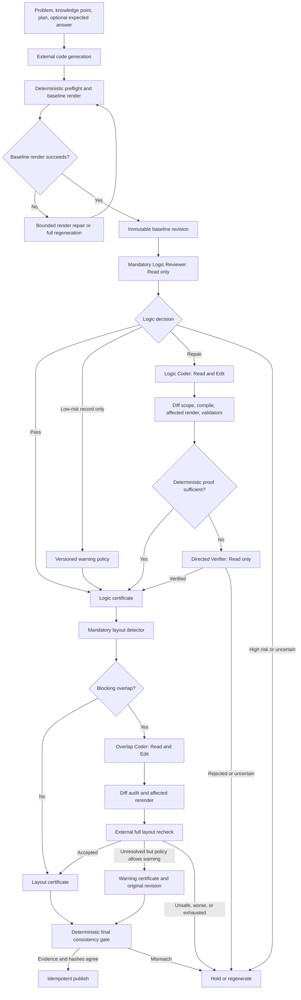

# Manim Quality Platform Agent Architecture and Test Report

- Report date: 2026-07-13
- Evidence window: 2026-07-10 to 2026-07-13
- Platform workspace: `D:\manim_quality_platform`
- Evaluation worktree: `D:\codex-worktrees\manim_quality_platform\workbench-e2e-45`
- Evaluation branch: `codex/workbench-e2e-45`
- Current checked-in revision: `18a94aed86047f2069eb1b9d277cbfdf2e1f8980`
- Report type: technical architecture, Agent behavior, Harness controls, and test evidence

## 1. Purpose and reporting rules

This report explains the current Manim quality platform as an engineering system,
not as a single success-rate number. It covers:

1. the complete quality pipeline and ownership boundaries;
2. the roles, inputs, tools, outputs, and limits of every Agent;
3. the logic-review, logic-repair, overlap-detection, and overlap-repair paths;
4. the external gates that decide whether an Agent patch may be adopted;
5. the main evaluation rounds and why their results differ;
6. the current verified capabilities, unresolved risks, and next engineering work.

Four results must remain separate throughout this report:

- **renderable**: Manim produced a readable video;
- **logic certified**: the mandatory Reviewer found no evidenced blocker, or a
  repair passed the required verification path;
- **strict visual release**: no blocking layout issue remains and every gate passes;
- **warning release**: a readable original is retained with unresolved or low-risk
  evidence; this is not equal to strict customer delivery.

An Agent saying that it fixed a problem is never acceptance evidence.

## 2. System decision

The platform is a versioned, bounded quality state machine implemented as an
independent modular monolith. It is not a free-form multi-Agent conversation.

The central decisions are:

- generation remains outside the quality platform behind a versioned submission
  contract;
- every renderable candidate must pass the read-only Logic Reviewer;
- the Logic Coder runs only when the Reviewer returns a repairable blocking issue;
- every logic-certified candidate runs the deterministic layout detector;
- the overlap Coder runs only when blocking layout evidence exists;
- only the Quality Orchestrator can accept a revision, create a checkpoint, hold a
  job, or publish a result;
- every edit creates an immutable child revision, so failed patches cannot overwrite
  the last certified revision;
- every Agent patch is independently rerendered and rechecked outside the SDK;
- infrastructure, evidence, budget, renderer, or SDK errors fail closed.

This design uses Claude Agent SDK as the constrained execution Harness. The model
used in the recorded live evaluations was `gemini-3.5-flash-high` through an
Anthropic-compatible `/v1/messages` gateway. Therefore, the SDK supplies the Agent
runtime, tool mediation, hooks, and structured execution; it is not the model.

## 3. End-to-end architecture

The order is intentionally logic first, layout second. A logic patch can change
formulas, geometry coordinates, object structure, and animation timing, invalidating
any earlier overlap evidence.

## 4. Component responsibilities

| Component | Runs when | Tools | Main responsibility | Cannot do |
|---|---|---|---|---|
| Code generator | Before quality flow | Provider API | Produce complete Manim code | Certify quality |
| Render recovery | Baseline render failure | External renderer/regeneration | Recover syntax, API, or render failures | Judge mathematical truth |
| Logic Reviewer | Every renderable job | `Read` | Find evidenced mathematical or teaching contradictions | Edit, render, publish |
| Logic Coder | Reviewer returns repair | `Read`, `Edit` | Patch only the frozen issues and declared Scene scope | Broaden task, certify its patch |
| Directed Verifier | Logic patch lacks deterministic proof | `Read` | Verify only frozen issues against patch evidence | Perform a new open-ended review |
| Layout detector | Every logic-certified revision | Deterministic probe | Produce time-bound object and collision facts | Modify code |
| Overlap Coder | Blocking layout evidence exists | `Read`, `Edit` | Repair layout while preserving logic | Run shell, publish, self-accept |
| Final consistency gate | Every publish candidate | Deterministic checks | Bind revisions, hashes, certificates, render evidence | Call an LLM or invent missing evidence |
| Quality Orchestrator | Entire job | Typed ports | Own state, retries, checkpoints, rollback, and publish | Delegate acceptance authority |

## 5. Agent input and output contracts

### 5.1 Logic Reviewer

The Reviewer receives:

- original problem or knowledge point;
- generation plan and Scene intent when available;
- expected answer or constraints only when supplied by the task source;
- a compact Scene index and logic evidence digest;
- the complete allowlisted `candidate.py`;
- a render manifest bound to the current code hash;
- optional deterministic geometric or symbolic facts.

It returns a structured decision:

- `PASS`: no directly evidenced blocking issue found;
- `REPAIR`: an issue is concrete, source-bound, and has an acceptance path;
- `RECORD_ONLY`: a low-risk observation with no independent acceptance meaning;
- `HUMAN_REVIEW`: high-risk, conflicting, or insufficient evidence.

Every issue must include severity, type, affected Scene, real source line bounds,
an exact excerpt, reasoning, and a repair/verification contract. A low-confidence
possible answer or geometry error cannot be downgraded to a harmless warning.

### 5.2 Logic Coder

The Coder does not receive the Reviewer's full conversation. It receives:

- frozen structured issues;
- declared target Scene and allowed edit regions;
- acceptance predicates;
- the current candidate;
- bounded retry evidence only after a failed first attempt.

The Coder may read and edit the task candidate. It has no Bash, arbitrary Write,
web access, repository exploration, upload, or task-spawning tool.

### 5.3 Directed Verifier

The Verifier receives only:

- original frozen issue order;
- before/after diff;
- deterministic validator results;
- patched target Scene and bound source evidence.

It does not redo the whole lesson review. It verifies whether each frozen issue is
resolved. Current Harness hardening supports multiple evidence excerpts for one
issue and evidence adjacent to a deleted faulty line.

### 5.4 Overlap Coder

The overlap path receives:

- the complete `candidate.py`;
- compact `layout_context.json` facts for blocking issues and required neighboring
  objects;
- object identities, roles, bounding boxes, visible intervals, overlap or overflow
  quantities, and source regions;
- the logic certificate summary as a protected constraint;
- prior patch and recheck evidence only for an allowed second attempt.

The layout context describes facts rather than prescribing a sample-specific fix.
The Agent decides whether to adjust positioning, spacing, grouping, scale, font size,
or a broader layout block. The outer platform rerenders and reruns the detector.

## 6. Tool, path, and secret controls

The Agent Harness enforces controls in code and hooks rather than relying on prompt
obedience:

- Reviewer and Verifier profiles allow only `Read`;
- Coder profiles allow only `Read` and `Edit`;
- Bash, Web, arbitrary Write, Agent/Task, upload, and repository exploration are
  denied;
- paths are resolved after following links and must stay inside the exact task
  workspace allowlist;
- parent traversal, alternate data streams, symlink escape, and junction escape are
  rejected;
- task sessions are stateless and cannot read unrelated jobs;
- renderer and layout-probe subprocess environments strip API keys, auth tokens,
  passwords, and secret-like variables;
- prompt, model, schema, validator, tool, and policy versions are recorded separately.

This is the main difference from earlier shell-heavy Agent experiments. The model
edits through a structured tool, while rendering, detection, acceptance, and rollback
remain outside the model session.

## 7. Bounded execution and failure behavior

Budgets are centralized policy fields, including:

- context bytes;
- turns and tool calls;
- wall-clock duration;
- input, output, cache-read, cache-write, and total tokens;
- repair attempts and generated revisions.

The product architecture allows at most two logic repairs and two overlap repairs,
with at most three Agent-created revisions per job. Evaluations may tighten this to
one attempt. A repeated patch hash, repeated error fingerprint, no improvement,
unsafe diff, or exhausted budget terminates the loop.

Failure handling is conservative:

- transient provider or recognized read-only tool-format errors may receive one
  bounded identical-input retry;
- semantic `HUMAN_REVIEW` is never retried as an infrastructure error;
- a failed patch leaves the certified parent revision untouched;
- a layout warning may retain the original readable video, but must not be counted
  as strict delivery;
- a checker process with nonzero exit overrides any stale `ok=true` payload.

## 8. Revision and acceptance model

Every candidate revision binds:

- parent revision and stage;
- full code hash and per-Scene code hashes;
- semantic fingerprint and layout-invariant fingerprint;
- affected Scenes;
- render manifest, renderer version, render configuration, and Scene order;
- evidence and policy versions.

The independent checkpoints are:

1. render baseline;
2. logic certified;
3. layout certified;
4. delivery.

The final consistency gate verifies that the selected revision, render, logic
certificate, layout certificate, warning authorizations, and hashes all refer to the
same evidence snapshot. This lightweight gate is required even though it does not
call an LLM.

## 9. Codebase structure and engineering condition

The current platform is organized as a modular monolith:

- `agents/`: Claude SDK backend, tool profiles, hooks, path guards, budgets, usage;
- `contracts/`: submission, revision, result, and quality-state schemas;
- `logic/`: evidence digest, Reviewer, Coder, validators, repair flow, Verifier;
- `geometry/`: static and captured geometric relation facts;
- `layout/`: detector adapter, policy, vendor runtime, classification, follow-up;
- `rendering/`: Manim adapter, render manifests, Scene impact, slice validation;
- `orchestrator/`: state machine, checkpoints, repair coordination, hold flow;
- `delivery/`: warning policy, consistency gate, certificate construction;
- `revisions/` and `storage/`: immutable revisions, persistence, queue/outbox;
- `modification/`: user-requested secondary modification flow;
- `observability/`: audit, metrics, alerts, and usage sinks.

Current `src/manim_quality` snapshot:

| Metric | Count |
|---|---:|
| Production Python files | 189 |
| Production lines | 18,589 |
| Test Python files | 131 |
| Test lines | 15,749 |
| Largest observed production module | 272 lines |

Production modules remain below the repository's 300-line hard limit. The worktree
currently contains uncommitted evaluation and logic-verification hardening, so the
exact source snapshot must be committed before a production release or a final
benchmark freeze.

Current full-suite verification on 2026-07-13 produced `1368 passed`, `2 failed`,
and `4 skipped` in 33.92 seconds. The two failures are fail-closed provenance
checks: the frozen overlap regression hash and the frozen logic source manifest no
longer match their materialized sources. They are not runtime Agent-test failures,
but they must be reconciled by a deliberate source-provenance update before release;
the report does not rewrite frozen hashes to make the suite green. The four skips
are Windows symlink tests unavailable without the required operating-system
privilege.

Ruff passed across the active `src`, `tests`, `evals`, and `scripts` trees. Generated
probe copies under the untracked `.tmp` directory are not treated as maintained
source. The focused report, mutation-builder, logic-verifier, and workbench tests
passed `39/39` after the report was assembled.

## 10. Test timeline

### 10.1 Initial launch validation

The first live launch-oriented probe correctly resulted in `HOLD`.

| Test | Result |
|---|---:|
| Frozen logic manifests | 3 packs, 36 cases structurally verified |
| Live Reviewer | 10 cases; bad-case recall 40%; good-case false positives 20% |
| Live logic repair | 3 attempted; 2 candidate-ready; 0 exact restorations |
| Modification E2E | 16 passed |
| Concurrent fake load | 100 completed; 0 dead letters; 0 duplicates; 2969 ms |

The Reviewer used 443,651 tokens and the repair probe used 95,816. This proved
Harness operation and fail-closed behavior, but not commercial logic quality.

### 10.2 Forty-five-job E2E evolution

Forty-five stochastic jobs were run as three rounds of 15 from a frozen pool of 20
medium-hard and hard topics.

| Round | Quality release | Strict | Warning | Held | Tokens | Average |
|---|---:|---:|---:|---:|---:|---:|
| 1 | 10/15 | 8 | 2 | 5 | 706,310 | 47,087 |
| 2 | 12/15 | 8 | 4 | 3 | 792,361 | 52,824 |
| 3 | 15/15 | 12 | 3 | 0 | 863,293 | 57,553 |
| Total, evolving configurations | 37/45 | 28 | 9 | 8 | 2,361,964 | 52,488 |

The improvement came from general Harness changes:

- one transient/incomplete generation retry;
- generic Manim Pango and LaTeX constraints;
- correct low-risk `record_only` routing;
- one bounded full regeneration after baseline render failure;
- stronger universal restrictions on Chinese in `Tex/MathTex` and overlapping
  Pango mapping keys.

Across these evolving rounds, the Logic Reviewer attempted 39 jobs and completed
38 pass plus one record-only decision. Logic Coder triggered zero times. The layout
Agent triggered 12 times, reduced aggregate blocking from 36 to 6, and seven changed
candidates were accepted. Therefore, this run proved the E2E route and overlap
repair, but not logic repair.

The latest 15/15 quality release must not be read as 100% strict commercial yield:
it contained three warning releases, silent low-resolution validation videos, and
stochastic generation.

### 10.3 High-success prompt replication: 15 tasks

This batch generated fresh code using the strongest Round 3 prompt selection.

| Metric | Result |
|---|---:|
| Raw strict | 7/15 |
| Raw warning | 7/15 |
| Raw hold | 1/15 |
| Operationally recovered after bounded diagnosis | 15/15 |
| First-pass baseline render | 14/15 |
| Final readable videos | 15/15 |
| Total raw tokens | 1,113,724 |
| Average raw tokens | 74,248 |

This batch contains one important natural logic-repair example. `slot-043` claimed
that a point was a midpoint and a constructed segment was parallel to another
segment, while its coordinates contradicted both claims. The Reviewer localized the
contradictions; the Logic Coder corrected the coordinate block; the new video
rerendered and stayed layout-clean.

The overlap stage detected nine jobs after diagnosis. Two patches were accepted;
several cleaner candidates were blocked by the semantic fingerprint, and at least
one zero-overlap candidate was correctly rejected because it removed a highlight and
made content nearly invisible. This proves that blindly relaxing the gate is unsafe.

### 10.4 Random-hard replication: 15 tasks

This was a fresh sample without replacement from the 17 hard tasks in the frozen
pool.

| Metric | Result |
|---|---:|
| Strict release | 6/15, 40.0% |
| Warning release | 9/15, 60.0% |
| Baseline render | 15/15 |
| Logic Reviewer | 15 pass |
| Logic repair | 0 |
| Blocking overlap detected | 9/15 |
| Overlap repair adopted | 0/9 |
| Total tokens | 1,129,543 |
| Average tokens | 75,303 |

Six overlap candidates reached zero blocking, but the acceptance layer rejected or
failed to adopt them. This replication showed that the earlier high release rate did
not generalize as a strict visual yield. It justified stopping blind batch scaling
and focusing on the overlap decision layer.

### 10.5 Ten-case logic mutation benchmark

Ten rendered, previously correct real candidates were modified with logic faults
from easy arithmetic to expert geometry and graph errors. The mutations included:

- wrong displayed area or quadratic root;
- wrong conditional probability reasoning;
- invalid algebraic transformation;
- incorrect geometric point position, tangent point, or parallel construction;
- wrong chord endpoint;
- wrong hyperbola curve.

Reviewer result:

| Metric | Result |
|---|---:|
| Known-bad attempted | 10 |
| Target error detected | 10/10 |
| Errors after bounded correction | 0 |
| Reviewer tokens | 440,118 |
| Average Reviewer tokens | 44,012 |
| Average Reviewer turns | 3.5 |

Repair evolution:

| Stage | Result |
|---|---:|
| First repair pass | 7/10 candidate-ready and exact target restoration |
| First repair tokens | 396,578 |
| Diagnostic retry of three failures | 0/3 accepted; 114,080 tokens |
| General Harness retry | 3/3 candidate-ready; 154,518 tokens |
| Final external render validation | 10/10 rendered |
| Final semantic comparison | 9 exact original, 1 equivalent correct result |

The general Harness changes were not keyed to sample names or topics:

- increased the Coder turn cap from five to seven for bounded tool completion;
- allowed multiple bound evidence excerpts for one frozen issue;
- allowed Verifier evidence adjacent to a deleted faulty line;
- bound the rendered mutant manifest without leaking the known-good truth label;
- corrected explicit manifest selection in evaluation CLIs.

The recorded iterative experiment spend, including Reviewer, first repair, failed
diagnostic retry, and final retry, was 1,105,294 model tokens. This is investigation
cost, not the expected production cost per job.

This benchmark gives strong small-sample evidence that the logic path can detect and
repair diverse source-level faults. It is still a mutation benchmark derived from
known-good candidates, not a large blind estimate of real production recall.

### 10.6 New 20-task medium-hard/hard holdout

This run used 20 new tasks and fresh stochastic code generation. It did not reuse
the 10 mutation candidates.

| Metric | Result |
|---|---:|
| Baseline renderable | 20/20 |
| First-pass strict | 10/20 |
| First-pass warning | 9/20 |
| First-pass logic hold | 1/20 |
| Bounded identical-input Reviewer recovery | 1/1 |
| Final readable videos | 20/20 |
| Strict after recovery | 11/20, 55% |
| Evidence-adjusted visually acceptable | about 13/20, 65% |
| Logic Coder triggered | 0 |

Logic audit:

- 19 Reviewer calls passed on the first attempt;
- one call attempted a nonexistent helper path and failed closed;
- the same candidate and evidence passed one bounded retry;
- independent visible-claim extraction matched the frozen expected solutions;
- critical-frame and static-geometry inspection found no evidenced mathematical
  contradiction;
- because no candidate received `needs_repair`, none entered Logic Coder.

Layout audit:

| Classification | Count | Slots |
|---|---:|---|
| Strictly accepted overlap repairs | 2 | 008, 019 |
| Real clipping or overlap retained | 6 | 002, 003, 005, 011, 012, 015 |
| Detector false positives | 2 | 009, 016 |
| Minor visual contact | 1 | 010 |

Five Agent candidates reached zero blocking but were rejected by the semantic
fingerprint. Three calls exceeded the 60k remaining-token budget. One produced no
useful change. The original readable video was retained for warnings.

Token and throughput profile:

| Stage | Tokens |
|---|---:|
| Generation | 510,743 |
| Logic Reviewer first pass | 372,992 |
| Logic Reviewer retry | 17,190 |
| Logic Coder | 0 |
| Layout stage | 546,477 |
| Total | 1,447,402 |
| Average | 72,370 per task |

The three-worker wall time was 840.8 seconds, about 14 minutes. All 20 final MP4s
were independently read by ffprobe and were 44.87 to 71.80 seconds long.

## 11. Consolidated capability assessment

| Capability | Current evidence | Assessment |
|---|---|---|
| External generation ingestion | 45-job and 20-job E2E | Implemented and operational |
| Baseline rendering and bounded recovery | Multiple fresh batches | Stable in current samples |
| Mandatory Logic Reviewer | Every renderable job in current E2E | Operational |
| Logic error detection | 10/10 mutation benchmark; one natural contradiction | Promising, sample still small |
| Logic repair | 10/10 final mutation validation; one natural repair | Demonstrated, not yet broad production recall |
| Layout detection | Finds real issues but also axis/tick false positives | Useful but requires calibration |
| Overlap repair generation | Produces zero-blocking candidates in many cases | Agent ability is present |
| Overlap patch acceptance | 2/11 accepted in latest holdout | Current primary bottleneck |
| Immutable rollback and fail-closed behavior | Unit, load, and live fault evidence | Strong |
| Commercial finished video | No TTS/audio in these validation runs | Not tested by this report |

## 12. Why the results changed between rounds

The reported rates changed because the experiments measured different things:

1. early launch probes used small known-good/known-bad packs and exposed weak
   Reviewer recall;
2. the 45-job run evolved its Harness across three configurations and counted
   warning releases separately from strict releases;
3. the high-success 15 used the strongest prompt distribution and included one
   successful real logic repair;
4. the random-hard 15 deliberately stressed hard topics and exposed the overlap
   acceptance bottleneck;
5. the mutation 10 supplied guaranteed errors, so it exercised Logic Coder on every
   case;
6. the new natural 20 contained no evidenced logic error, so it exercised Reviewer
   coverage but Logic Coder zero times.

These runs must not be averaged into one universal success rate. The closest current
estimate of strict end-to-end visual yield on a fresh holdout is 11/20, or 55%, with
an evidence-adjusted visually acceptable estimate of about 65% after removing two
clear detector false positives.

## 13. Main technical bottlenecks

### 13.1 Layout semantic acceptance

The binary layout-invariant fingerprint is too coarse for some safe edits but is
also preventing genuinely harmful zero-overlap patches. The solution is not to
disable it. The next gate should classify patch types:

- low risk: rigid translation, label direction/buff, container width, bounded font
  size, layout-only grouping;
- elevated risk: constructor replacement, object deletion, formula/text edits,
  animation-mechanism rewrites, visibility and color changes;
- always require zero or policy-approved residual blocking, successful rerender,
  unchanged mathematical claims, and visual regression evidence.

### 13.2 Detector false positives

Axes, tick labels, intentional containment, and animation transitions still create
false blocking evidence. Detector output needs role-aware and time-aware
classification before invoking an expensive Agent.

### 13.3 High-overlap global layouts

Some jobs contain many internal collisions. Local movement is unlikely to repair a
bad global plan in one bounded round. These cases should route to one layout-aware
regeneration rather than repeatedly spending overlap Agent tokens.

### 13.4 Logic generalization evidence

The logic mutation benchmark is strong but small. Production readiness still needs:

- a frozen known-good set for false-positive and over-edit rates;
- a blind known-bad set from real generation failures;
- independently authored expected answers and geometry predicates;
- full patch, rerender, and blind before/after validation;
- separate reporting by error family and difficulty.

## 14. Required metrics for the next release gate

The next evaluation should report at least:

- critical logic recall and overall precision;
- known-good false-positive and over-edit rates;
- logic repair success after external rerender;
- layout detector blocking recall and false-positive rate;
- overlap blocking-clear rate;
- accepted-worse rate;
- strict automatic delivery rate;
- warning and hold rates;
- sampled customer-quality video rate;
- p50, p95, and maximum tokens and latency by Agent role;
- repeated-patch, budget-exhaustion, stale-evidence, and revision-mismatch counts.

Prompt tuning, policy tuning, and final acceptance must use separate datasets. No
condition may branch on a sample ID, exact title, problem text, object name, or
dataset directory.

## 15. Current conclusion

The system is now a complete quality Agent platform rather than a prompt wrapper:
it has constrained Agent roles, deterministic external tools, immutable revisions,
bounded repair loops, independent verification, rollback, evidence persistence, and
a final consistency gate.

The logic direction is technically validated but not statistically complete. The
10-case mutation benchmark and one natural repair show that Reviewer, Coder,
validators, and Verifier can perform substantive repairs. The new 20-task natural
holdout did not contain an evidenced logic error, so it cannot add repair-recall
evidence.

The current commercial bottleneck is layout quality and acceptance. All 20 new tasks
rendered, but only 11 were strict autonomous releases. Two additional cases appear
acceptable after evidence review, while six retained real clipping/overlap and one
retained a minor contact. The next engineering cycle should prioritize a typed
layout-patch gate and role-aware detector calibration before another large batch.

These validation videos are silent low-resolution engineering artifacts. Audio,
TTS synchronization, pedagogy, pacing, and final customer scoring remain separate
production gates.

## 16. Evidence index

Architecture and Harness:

- `D:\codex-worktrees\manim_quality_platform\workbench-e2e-45\AGENTS.md`
- `D:\codex-worktrees\manim_quality_platform\workbench-e2e-45\docs\architecture\QUALITY_PLATFORM.md`
- `D:\codex-worktrees\manim_quality_platform\workbench-e2e-45\docs\engineering\HARNESS.md`

Historical validation:

- `D:\codex-worktrees\manim_quality_platform\workbench-e2e-45\docs\evidence\task-14-launch-validation.md`
- `D:\codex-worktrees\manim_quality_platform\workbench-e2e-45\docs\evidence\workbench-e2e-45-final.md`
- `D:\manim_quality_platform_runs_20260712\workbench_e2e_45\report.json`
- `D:\manim_quality_platform_runs_20260712\workbench_e2e_45\before_after.html`

2026-07-13 replications:

- `D:\manim_quality_platform_runs_20260713\high_success_replication_15\DETAILED_REPORT.md`
- `D:\manim_quality_platform_runs_20260713\random_hard_replication_15_b\DETAILED_REPORT.md`

Logic mutation evidence:

- `D:\manim_quality_platform_runs_20260713\logic_mutation_real10_v1_reviewer\shadow_report.json`
- `D:\manim_quality_platform_runs_20260713\logic_mutation_real10_v1_repair\repair_shadow_report.json`
- `D:\manim_quality_platform_runs_20260713\logic_mutation_real10_v1_repair_retry3\repair_shadow_report.json`
- `D:\manim_quality_platform_runs_20260713\logic_mutation_real10_v1_repair_retry3b\repair_shadow_report.json`
- `D:\manim_quality_platform_runs_20260713\logic_mutation_real10_v1_final_validation\semantic_results.csv`
- `D:\manim_quality_platform_runs_20260713\logic_mutation_real10_v1_final_validation\render_results.csv`

New 20-task holdout:

- `D:\manim_quality_platform_runs_20260713\workbench_holdout20_v1\VALIDATION_REPORT.md`
- `D:\manim_quality_platform_runs_20260713\workbench_holdout20_v1\report.json`
- `D:\manim_quality_platform_runs_20260713\workbench_holdout20_v1\report.csv`
- `D:\manim_quality_platform_runs_20260713\workbench_holdout20_v1\stage_summary.csv`
- `D:\manim_quality_platform_runs_20260713\workbench_holdout20_v1\before_after.html`
- `D:\manim_quality_platform_runs_20260713\workbench_holdout20_v1\qa_contact_70pct.png`
- `D:\manim_quality_platform_runs_20260713\workbench_holdout20_v1\qa_warning_contact.png`

No API key or secret value is included in this report.
